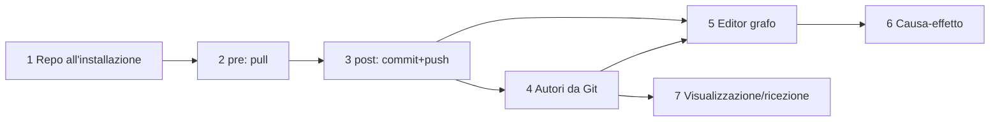

# Roadmap: Teseo collaborativo — dal vault installato alla gestione condivisa del grafo

## Summary
Porta Teseo dal modello attuale ("pubblicazione manuale con consenso dalla dashboard") al flusso
dell'utente: installazione che crea il repository dati, pull automatico prima e commit+push
automatico dopo ogni ingest/lint/fill-gaps, autori delle note ricavati dalla storia Git, dashboard
che legge **e modifica** il grafo (relazioni, causa-effetto, alias, tag, proprietà) in collaborazione.

Scope XL → diviso in 7 fasi, ciascuna pianificabile e consegnabile separatamente (una o più PR).
Il piano dettagliato delle fasi 1–3 è in
[teseo-autosync-git.plan.md](teseo-autosync-git.plan.md); le fasi 4–7 riceveranno il proprio
`.plan.md` con `/ecc:prp-plan` quando la fase precedente è chiusa.

## User Story
Come autore di un vault Teseo condiviso con colleghi, voglio che ogni operazione sul vault parta
dall'ultima versione comune e finisca pubblicata, sapendo chi ha scritto cosa, e voglio correggere
il grafo dalla dashboard, così che il gruppo lavori su un'unica base di conoscenza senza passaggi Git
manuali.

## Problem → Solution
Oggi: ~12 passi manuali per un push, nessun hook Git, `automatic=False` cablato
(`kit/dashboard/sync_service.py:150`, `kit/dashboard/receiver.py:105,112`), nessun autore per nota,
dashboard che disegna 12 nodi e modifica solo l'ontologia (`kit/dashboard/ui_script.py:115`).
→ Installazione con `--collabora <remote>`, `teseo_git.py pre|post` invocato dalle skill, autori in
tabella `autori` del grafo, editor del grafo nella dashboard con lo stesso percorso
preview → apply → rebuild → post.

## Metadata
- **Complexity**: XL (suddiviso)
- **Source PRD**: N/A (requisiti dell'utente + analisi ECC del 2026-10-27)
- **Estimated Files**: ~30 in totale

---

## Decisioni da confermare prima di implementare (Ambiguity Gate)

| # | Decisione | Default raccomandato | Perché |
|---|---|---|---|
| D1 | Sostituire il principio "nessuna automazione" con un **autosync opt-in per vault** | Sì, con ADR + consenso esplicito una sola volta (all'installazione o dalla dashboard) | È il requisito dell'utente; l'opt-in conserva la sicurezza per chi non collabora |
| D2 | Conflitto sulla **stessa nota** fra due utenti | L'autosync si ferma; risoluzione revisionata nella dashboard (`sync/resolve`, già esistente) | Unire automaticamente testo semantico rischia perdite silenziose |
| D3 | Conflitti su `log.md` / `index.md` | Unione automatica `git merge-file --union` solo per questi due file | Ogni skill ci appende: senza unione ogni ciclo concorrente confligge |
| D4 | Fonti **binarie** in `raw/` (PDF, DOCX) | Restano locali (policy attuale `_TEXT_RAW`, `git_sync.py:23`), escluse via `.git/info/exclude` e segnalate | Le fonti sono immutabili ma pesanti; si condivide il testo distillato |
| D5 | Vault **già in uso** (legacy) e `--collabora` | Ammesso con conferma esplicita: crea `.teseo/project.json` (oggi rifiutato in `installa.py:354-359`) | Il flusso dell'utente parte da vault esistenti |
| D6 | Creazione del repo remoto | Opzionale con `gh repo create --private` se `gh` è autenticato, previa conferma; altrimenti URL fornito | L'installer non deve pubblicare nulla senza consenso |
| D7 | Autore delle note | **Derivato da Git** (autore commit = persona; trailer `Teseo-Agent`/`Teseo-Skill` = agente e operazione). Nessun campo nel frontmatter | Un campo frontmatter rompe `build_graph --check` (`build_graph.py:56,234-239`) e genera conflitti |
| D8 | Modello causa-effetto | Nuova relazione `causa` (Da: qualsiasi → A: qualsiasi) nel vocabolario; attributi d'arco (confidenza/evidenza) **fase 6**, in sezione `relazioni_dettaglio` | Il parser accetta solo liste di link per proprietà |
| D9 | Visualizzazione del grafo | Layout a forze in JS vanilla dentro `ui_script.py` (CSP con nonce, nessuna CDN) | La UI non carica risorse esterne |

---

## Stato (2026-10-28)

Fasi 1–3 consegnate con il piano autosync. **Fasi 4–7 implementate** e documentate in [doc/10](../../../doc/10-editor-grafo-e-autori.md). Scostamenti dal piano: gli autori si raccolgono in `kit/dashboard/authors.py` e `graph_service.rebuild` (il builder lavora su copie senza `.git`); l'HEAD entra nell'identità della generazione (builder v4); la ricezione è abilitata anche su POSIX (non solo documentata la sostituzione con `pre`); l'editor pubblica senza eseguire `build_graph.py --check` (graph_check=False). Fuori scopo, invariati: creazione/rinomina/eliminazione di pagine.

## Fasi

| # | Fase | Prerequisiti | Consegna | Piano |
|---|---|---|---|---|
| 1 | Repository dati all'installazione | D1, D4, D5, D6 | `installa.py --collabora <url>`: manifest, `git init`, exclude locali, commit iniziale, primo push, consenso autosync | autosync-git, Task 1–4 |
| 2 | Pre-hook `pull` | 1 | `.graph/teseo_git.py pre --skill X`: fetch, fast-forward, rebuild, sessione aperta | autosync-git, Task 5–7 |
| 3 | Post-hook `commit+push` | 2, D2, D3 | `.graph/teseo_git.py post`: check grafo, commit attribuito con trailer, integrazione, push, adozione; skill aggiornate | autosync-git, Task 8–13 |
| 4 | Autori dalla storia Git | 3, D7 | Tabella `autori` in `graph.sqlite`, API nodo, filtro "autore" nella UI | da pianificare |
| 5 | Editor del grafo nella dashboard | 3, 4 | Rotte `nodes/{id}/edit/preview|apply`: relazioni, alias, tag, `tipo`; apply journalizzato → rebuild → `post --skill dashboard` | da pianificare |
| 6 | Causa-effetto | 5, D8 | Relazione `causa` + attributi d'arco opzionali; editor e filtro "catena causale" | da pianificare |
| 7 | Visualizzazione e ricezione | 4 | Layout a forze, zoom/pan, vicinato espandibile; `SessionStart` readonly "N aggiornamenti remoti"; ricezione non solo Windows | da pianificare |

### Criteri di accettazione per fase

**Fase 4 — Autori**
- `build_graph.py` popola `autori(entity_id, creato_da, creato_il, modificato_da, modificato_il, agente, modifiche)` leggendo
  una sola volta `git log --no-merges -M --name-status --format=…` su `wiki/`; tabella vuota se non c'è `.git`
  (build nelle copie isolate).
- I merge `Teseo <teseo@localhost>` (`git_sync.py:567,572,696`) non contano come autori.
- Le rinomine seguono le righe `R` di `--name-status`.
- `GET /nodes/{id}` espone `autori`; la UI mostra "creato da / ultima modifica" e filtra per autore.
- Nessuna modifica allo schema di `entities` (tabella nuova = nessuna rottura di `read_api.py:162`).

**Fase 5 — Editor del grafo**
- Operazioni atomiche su una pagina: `add_relation`, `remove_relation`, `set_aliases`, `set_tags`, `set_tipo`.
- Preview mostra il diff del frontmatter e l'esito di `build_graph --check` su copia isolata
  (pattern `ontology_preview.py` / `ontology_apply.py`: snapshot, journal, rollback).
- Apply sotto `VaultLock`, poi rebuild (`graph_service.rebuild`), poi pubblicazione con lo stesso motore
  della fase 3 (`skill='dashboard'`).
- Creazione/rinomina/eliminazione di pagine restano fuori (mapping `page.renamed` oggi bloccato).

**Fase 6 — Causa-effetto**
- `causa` nel vocabolario di `kit/vault/Wiki reference.md` e in `ontology.py`; skill ingest/lint istruite a dichiararla
  solo se la fonte la afferma.
- Attributi opzionali in `relazioni_dettaglio:` (mappa `"[[Y]]": {confidenza, evidenza}`) aggiunta a `NON_RELAZIONI`
  e validata; tabella `relation_attributes`.
- UI: filtro "catena causale" (cammino orientato su `causa`).

**Fase 7 — Visualizzazione e ricezione**
- Layout a forze con limite configurabile (≥200 nodi fluidi), zoom/pan, click = espandi vicinato, colori per tipo.
- Hook `SessionStart` readonly: solo `fetch` + messaggio, mai scritture (timeout 15 s, `settings.json:6`).
- Ricezione disponibile su macOS/Linux (oggi `receiver_apply.py:71` solo Windows), oppure documentato
  che `teseo_git.py pre` la sostituisce.

---

## Rischi trasversali
| Rischio | Probabilità | Impatto | Mitigazione |
|---|---|---|---|
| Il modello salta il passo `pre`/`post` della skill | Media | Medio | `post` senza sessione pubblica come `manuale`; `pre` successivo rifiuta lavoro non pubblicato |
| Obsidian scrive durante `post` | Media | Medio | `checkpoint` verifica hash/HEAD (`git_sync.py:466-468`); fallimento → stato conservato, nuovo `post` |
| Limite 128 commit blocca il push | Certa dopo ~128 cicli | Alto | Audit incrementale (piano autosync, Task 9) |
| La validazione d'integrazione chiede spesso una decisione umana | Media | Medio | `needs_decision` ferma e rimanda alla dashboard; misurarne la frequenza nel collaudo |
| Credenziali assenti | Media | Basso | `_env()` già non interattivo (`git_sync.py:82-96`); stato `waiting_auth` con istruzioni |
