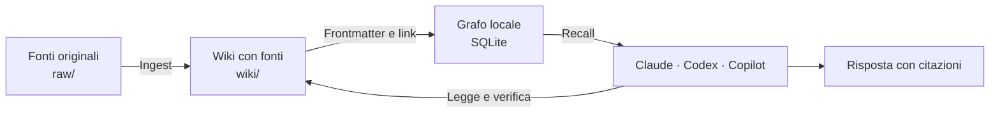
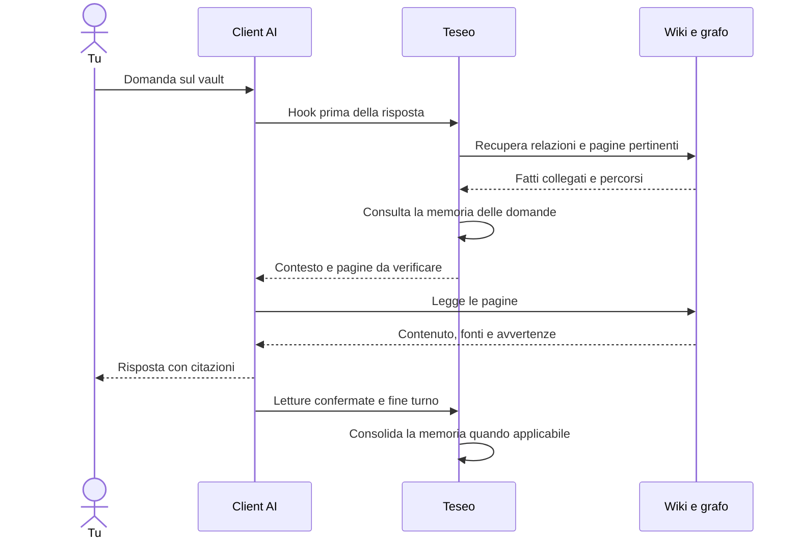
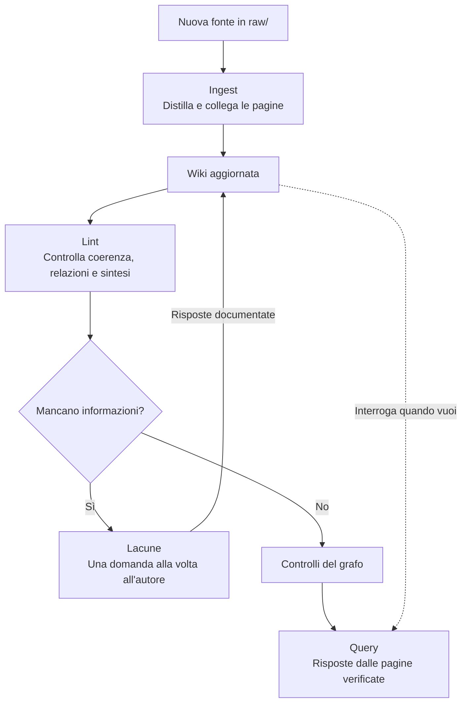

<div align="center">

# Teseo

**Trova la strada nel labirinto dei tuoi documenti.**

Una wiki Obsidian costruita dai tuoi documenti, con fonti verificabili, grafo delle relazioni e memoria delle domande.

[](#requisiti)
[](#dentro-il-vault)
[](#client-supportati)

[Installazione](#installazione-rapida) · [Primo utilizzo](#primo-utilizzo) · [Come funziona](#come-funziona) · [Domande frequenti](#domande-frequenti) · [Contribuire](#contribuire)

</div>

---

Nel progetto, **Teseo è l'assistente** che esplora il labirinto dei documenti. Il **grafo è il filo di Arianna**
che lo orienta tra le pagine e le loro relazioni.

Teseo trasforma trascrizioni, specifiche e appunti in pagine collegate. Quando fai una domanda, il grafo aiuta
l'assistente a trovare le pagine utili, anche quando la risposta attraversa più documenti. L'assistente legge
le pagine e risponde citando le fonti; contraddizioni e informazioni mancanti restano visibili.

Funziona con **Claude Code, Codex e GitHub Copilot CLI**. Puoi usarne uno solo oppure alternarli sullo stesso vault.
Obsidian è facoltativo: i contenuti sono normali file Markdown.

## Perché Teseo

| Capacità | Cosa ottieni |
| --- | --- |
| **Wiki dalle fonti** | Note per concetto, persona e processo, aggiornate quando aggiungi un documento. |
| **Relazioni esplicite** | Collegamenti come `usa`, `richiede` e `referente`, per ricostruire una risposta attraverso più pagine. |
| **Recall a ogni domanda** | Gli hook portano nel contesto del modello i fatti collegati e le pagine da verificare. |
| **Memoria delle letture** | Le pagine effettivamente lette aiutano a recuperare risposte a domande simili. |
| **Lacune da risolvere** | Referenti mancanti, contraddizioni e punti aperti diventano domande per l'autore. |
| **Controlli ripetibili** | Verifiche di link, relazioni, fonti, sintesi e recupero delle pagine attese. |



## Installazione rapida

### Requisiti

- **Git** e **Python 3.9+**, con SQLite FTS5 disponibile nella distribuzione Python.
- **Un client AI installato e autenticato**: Claude Code, Codex oppure GitHub Copilot CLI.
- **Obsidian**, se vuoi navigare la wiki dalla sua interfaccia.

L'unica dipendenza Python aggiuntiva è **PyYAML**. Il grafo usa SQLite: non devi avviare un server di database.
Le chiamate al modello usano il client e l'account che hai configurato.

### 1. Scarica il kit

Apri un terminale ed esegui:

```sh
git clone https://github.com/manuel-albanesee/Teseo.git
cd Teseo
```

### 2. Prepara Python e prova il kit

Scegli i comandi per il tuo sistema e continua nello stesso terminale. L'ambiente virtuale tiene le dipendenze
del kit separate dagli altri progetti Python.

<details open>
<summary><strong>Windows · PowerShell</strong></summary>

```powershell
python -m venv .venv
.\.venv\Scripts\Activate.ps1
python -m pip install -r kit/vault/requirements.txt
python installa.py --prova
```

Se sul tuo PC Python si avvia con `py`, usa `py -3 -m venv .venv` nella prima riga.

</details>

<details>
<summary><strong>macOS / Linux · Bash o Zsh</strong></summary>

```sh
python3 -m venv .venv
source .venv/bin/activate
python -m pip install -r kit/vault/requirements.txt
python installa.py --prova
```

</details>

La prova installa un vault d'esempio in una cartella temporanea, esegue i controlli e la cancella.
**Il risultato atteso è `tutto OK`.** Non chiama modelli e non richiede di configurare un vault personale.

### 3. Installa nel tuo vault

Sostituisci il percorso con quello della tua cartella Obsidian. Puoi indicare una cartella nuova: verrà creata.

**Windows:**

```powershell
python installa.py "C:/Obsidian/MioVault"
```

**macOS / Linux:**

```sh
python installa.py "$HOME/Documents/MioVault"
```

Il comando senza opzioni prepara **tutti e tre i client dentro il vault**, incluse le quattro skill per ciascuno.
Puoi preparare i file anche dei client che non hai installato. Per sceglierne uno solo:

```sh
python installa.py "PERCORSO_DEL_VAULT" --client claude
python installa.py "PERCORSO_DEL_VAULT" --client codex
python installa.py "PERCORSO_DEL_VAULT" --client copilot
```

**Hai già delle note?** L'installatore conserva le pagine e le fonti esistenti. Per farle riconoscere al grafo,
segui [Adattare un vault già in uso](ADATTA.md): le pagine della wiki devono essere in `wiki/*.md`, senza sottocartelle.

### 4. Apri il vault nel client

Apri come progetto **la cartella del vault**. Per usare una CLI, spostati in quella cartella dal terminale
con l'ambiente Python attivo e avvia `claude`, `codex` oppure `copilot`.

| Client | Passaggio iniziale |
| --- | --- |
| **Claude Code** | Accetta il normale consenso del progetto e verifica il caricamento degli hook locali. |
| **Codex** | Riapri il progetto, usa `/hooks` nella CLI e revisiona i quattro comandi verso `.graph/codex_hook.py`. |
| **Copilot CLI** | Accetta il normale consenso del workspace. `/env` mostra gli hook; `/instructions` le istruzioni; `copilot skill list` elenca le skill. |

I file di configurazione preparano l'integrazione; l'esecuzione degli hook dipende anche dalla versione del client
e dal suo consenso al progetto. L'installatore non modifica account, permessi o trust globali.

## Primo utilizzo

Apri il vault anche in Obsidian, se lo usi, e copia una fonte in `raw/`, per esempio `raw/riunione-progetto.md`.
Nella chat del client puoi scrivere direttamente:

| Obiettivo | Scrivi all'assistente |
| --- | --- |
| Aggiungere una fonte | `Ingerisci raw/riunione-progetto.md` |
| Cercare una risposta | `Quali sono i prerequisiti del rilascio e chi è il referente? Cita le pagine.` |
| Controllare la wiki | `Lancia il lint del vault` |
| Completare ciò che manca | `Colmiamo le lacune, una domanda alla volta` |

L'assistente usa le skill `obsidian-wiki-ingest`, `obsidian-wiki-query`, `obsidian-wiki-lint` e
`obsidian-wiki-fill-gaps`. Dopo l'ingest, il ciclo consigliato è **lint → lacune**.

Per esplorare prima un esempio completo, installa in una **cartella nuova dedicata**:

```sh
python installa.py "PERCORSO_DI_UN_VAULT_DEMO" --esempio
```

Poi chiedi: **«Devo fare un rilascio in produzione: cosa mi serve e chi me lo dà?»**
Il vault d'esempio collega Rilascio in produzione, Console di rilascio, Incident settimanale e Anna Rossi.
Contiene anche una contraddizione sul giorno del rilascio, che deve restare esplicita nella risposta.

## Come funziona

### Dalla domanda alla risposta

Gli hook richiamano il motore Python prima della risposta. Il **recall** recupera le relazioni del grafo e,
quando utile, le pagine ricordate da domande simili. Se non trova agganci, può cercare nel testo delle pagine.
Questi risultati indicano dove leggere: l'assistente verifica sempre i fatti nei documenti della wiki.



La memoria apprende associazioni tra domande sul contenuto e pagine lette quando il grafo non ha riconosciuto
la domanda. Un risultato di `rg`, `grep` o `glob` non prova che una pagina sia stata letta.
Se il recall fallisce, l'assistente riceve indicazioni per cercare e verificare nelle pagine.

### Dalle fonti a una wiki che migliora



Il lint può scrivere pagine di sintesi quando la risposta è già distribuita in più note. Quando manca un fatto,
il sistema lo chiede all'autore. Le fonti originali in `raw/` restano immutabili.

## Client supportati

Tutti i percorsi della tabella sono relativi alla cartella del vault.

| Client | Istruzioni | Hook | Skill |
| --- | --- | --- | --- |
| Claude Code | `CLAUDE.md` | `.claude/settings.json` | `.claude/skills/` |
| Codex | `AGENTS.md` | `.codex/hooks.json` | `.agents/skills/` |
| Copilot CLI | `.github/copilot-instructions.md` | `.github/hooks/teseo.json` | `.github/skills/` |

<details>
<summary><strong>Claude Code: recall e routing Opus / Haiku</strong></summary>

Gli eventi `SessionStart`, `UserPromptSubmit`, `PostToolUse` e `Stop` passano attraverso `claude_hook.py`.
Il motore storico può affidare a Haiku le domande puntuali con contesto affidabile in una sessione Opus;
le domande ampie, le modifiche e i casi incerti restano a Opus. Il prefisso `@opus` evita il passaggio a Haiku.
Il wrapper lascia gli eventi importati da Copilot al suo adattatore dedicato.

</details>

<details>
<summary><strong>Codex: attivazione, memoria e ruoli Sol / Astra / Luna</strong></summary>

Gli eventi nativi sono `SessionStart`, `UserPromptSubmit`, `PostToolUse` e `Stop`.
Codex richiede la revisione degli hook: dopo averli modificati può chiedere una nuova autorizzazione.
Gli hook aggiungono il contesto e suggeriscono un ruolo; **non cambiano il modello della chat e non avviano altri modelli**.

| Ruolo in `.graph/codex.json` | Modello predefinito |
| --- | --- |
| Ricerca e lavoro sul vault | `gpt-6.1-sol` |
| Analisi profonda | `gpt-6-astra` |
| Domande puntuali con contesto affidabile | `gpt-6-luna` |

Gli identificativi sono configurabili in base ai modelli disponibili al tuo account.
Per le letture da shell che devono insegnare alla memoria, usa il token fornito dall'hook:

```sh
python .graph/leggi.py --turno TOKEN_FORNITO_DALL_HOOK "wiki/Nome pagina.md"
```

Senza token il comando legge soltanto. I token separano sessioni e turni, durano sette giorni e non contengono
il testo delle domande. Gli eventi che dichiarano un `agent_id` sono ignorati.

Per una query autonoma che sceglie effettivamente il modello, serve Codex CLI autenticata:

```sh
python .graph/chiedi_codex.py "chi è il referente del rilascio?"
python .graph/chiedi_codex.py "@astra confronta i processi di rilascio"
python .graph/chiedi_codex.py --ricerca astra "spiega il processo di rilascio"
python .graph/chiedi_codex.py --piano "chi è il referente del rilascio?"
```

`@sol` e `@astra` forzano il ruolo di ricerca. Se Luna fallisce o richiede ricerca, il comando prova una volta
il modello di ricerca. Il processo usa un sandbox di sola lettura, una sessione effimera e hook disabilitati
per evitare ricorsione. Ingest, lint e lacune si eseguono nella chat.
`--piano` mostra la scelta senza chiamare modelli o scrivere memoria; può ricostruire il grafo derivato.

</details>

<details>
<summary><strong>Copilot CLI: prompt, letture e compatibilità con Claude</strong></summary>

`userPromptSubmitted` prepara il recall; `userPromptTransformed` lo aggiunge al testo destinato al modello,
conservando il contenuto già trasformato dal runtime. `postToolUse` registra le letture `view` riuscite;
`agentStop` e `sessionEnd` chiudono il turno e la sessione. `sessionStart` fornisce le regole iniziali.
Risponde il modello attivo di Copilot, senza avviare Claude o applicare i ruoli Codex.

Copilot carica anche `.claude/settings.json` e `.claude/settings.local.json`. L'installatore migra gli handler
Teseo verso un wrapper che ignora i payload Copilot ed elimina i doppioni Teseo dal file locale,
conservando gli altri handler e i permessi. Le configurazioni cambiate hanno una copia di sicurezza.

Il formato è stato verificato con **Copilot CLI 1.0.83**. Le versioni senza `userPromptTransformed` richiedono
recall esplicito tramite la skill query. Riferimento: [hook Copilot CLI](https://docs.github.com/en/copilot/reference/hooks-reference).

</details>

## Dentro il vault

```text
MioVault/
├── raw/                    Fonti originali, immutabili
├── wiki/                   Pagine Markdown con frontmatter e wikilink
├── Wiki reference.md       Convenzioni, fonti e vocabolario delle relazioni
├── index.md                Indice delle pagine e punti aperti
├── log.md                  Cronologia delle operazioni
├── .graph/                 Script Python, grafo e memoria SQLite
├── .claude/                Configurazione e skill Claude Code
├── .codex/                 Hook Codex; skill in .agents/skills/
├── .github/                Configurazione e skill Copilot CLI
├── CLAUDE.md               Istruzioni Claude Code
└── AGENTS.md               Istruzioni Codex
```

Il grafo si ricostruisce dai file della wiki. Convenzioni e relazioni sono definite in `Wiki reference.md`,
così puoi adattare il kit al tuo dominio. Le pagine e le fonti sono dati da verificare, non istruzioni da eseguire.

## Aggiornamenti e opzioni

Dal repository Teseo, con l'ambiente Python attivo:

```sh
git pull
python installa.py "PERCORSO_DEL_VAULT"
```

Senza `--aggiorna`, gli script e le skill già presenti ma diversi dal kit sono conservati.
Per sostituirli, usa `--aggiorna`: i precedenti vengono salvati in `.graph_backup/<data-ora>/`.
Le personalizzazioni di dominio negli script vanno riportate dal backup: vedi [ADATTA.md](ADATTA.md#dopo-un-aggiornamento).
I file di istruzioni già presenti e i modelli personalizzati di `.graph/codex.json` sono conservati.

**Teseo è già installato e vuoi aggiungere un client?**

```sh
python installa.py "PERCORSO_DEL_VAULT" --client codex --solo-integrazione
python installa.py "PERCORSO_DEL_VAULT" --client copilot --solo-integrazione
```

`--solo-integrazione` aggiunge gli adattatori del client senza aggiornare script di dominio, pagine o database.
Con `--aggiorna --solo-integrazione` sostituisce soltanto gli adattatori selezionati e le skill, con backup.
Se un file di istruzioni era già personalizzato, integra le indicazioni del relativo modello in [kit/vault/](kit/vault/).

| Opzione | Effetto |
| --- | --- |
| `--client tutti` | Claude, Codex e Copilot nel vault; **predefinito**. |
| `--client claude`, `--client codex` o `--client copilot` | Configura il singolo client. |
| `--client entrambi` | Claude + Codex, per compatibilità con le versioni precedenti. |
| `--skill vault` | Skill locali al vault; **predefinito**. |
| `--skill utente` | Skill globali esplicite in `~/.claude/skills/`, `~/.agents/skills/` o `~/.copilot/skills/`. |
| `--skill no` | Non installa le skill. |
| `--solo-integrazione` | Aggiunge un client a un vault con Teseo già installato. |
| `--aggiorna` | Sostituisce script e skill diversi, con backup. |
| `--esempio` | Aggiunge il vault d'esempio, se `wiki/` non contiene pagine Markdown al primo livello. |
| `--prova` | Esegue la prova completa in una cartella temporanea, poi la elimina. |

## Domande frequenti

**Devo installare tutti e tre i client?** No. Ne basta uno, autenticato. Il default prepara le configurazioni
locali di tutti e tre per poter passare da un client all'altro.

**Serve Obsidian aperto?** No. Il kit lavora sui file Markdown e sui database SQLite del vault.

**I documenti restano sul mio computer?** File e database del kit sono locali. I contenuti letti dall'assistente
possono essere inviati al provider del modello secondo il funzionamento e la configurazione del client AI.

**Il grafo non trova una risposta: è un errore?** Può mancare un alias, una relazione o il fatto stesso.
L'assistente cerca nelle pagine, segnala ciò che manca e, quando applicabile, la memoria associa la domanda alle letture.

**Non arriva il recall automatico.** Verifica il progetto aperto, il consenso agli hook e la versione del client.
La skill query descrive anche il recall esplicito: resta utilizzabile se il client non supporta gli hook.

**PowerShell blocca l'attivazione dell'ambiente virtuale.** Puoi usare il Prompt dei comandi nella cartella Teseo
ed eseguire `.venv\Scripts\activate.bat`, poi continuare con gli stessi comandi `python`.

**`misura.py` fallisce nel mio vault.** Il banco predefinito si riferisce alle pagine d'esempio.
Adatta le domande e le pagine attese al tuo dominio seguendo [ADATTA.md](ADATTA.md#6-le-domande-di-prova).

## Contribuire

Per segnalare un problema o proporre una funzione, apri una [issue](https://github.com/manuel-albanesee/Teseo/issues).
Per una correzione, proponi una pull request con il comportamento atteso e i controlli eseguiti.

Dal repository, con le dipendenze installate:

```sh
python installa.py --prova
python -m unittest discover -s tests -v
```

Questi controlli non chiamano modelli: verificano installazione, convivenza degli hook, recall, routing,
memoria e conservazione dei dati. Per esplorare il codice:

| Percorso | Contenuto |
| --- | --- |
| [installa.py](installa.py) | Installazione, aggiornamenti e configurazione dei client. |
| [kit/graph/](kit/graph/) | Grafo, recall, hook, memoria, domande aperte e misure. |
| [kit/skills/](kit/skills/) | Le quattro operazioni della wiki. |
| [kit/vault/](kit/vault/) | Modelli delle convenzioni e delle configurazioni. |
| [kit/esempio/](kit/esempio/) | Vault dimostrativo e banco di prova. |
| [tests/](tests/) | Test di regressione delle integrazioni. |

<details>
<summary><strong>Comandi utili dalla cartella del vault</strong></summary>

| Comando | Uso |
| --- | --- |
| `python .graph/build_graph.py --check` | Valida e ricostruisce solo se valido; in caso di errore conserva il grafo precedente. |
| `python .graph/backup_personal.py` | Backup consistente di memoria/domande in `.teseo/local/backups/`, per vault con manifest compatibile. |
| `python .graph/recall.py "domanda"` | Mostra i fatti collegati dal grafo. |
| `python .graph/misura.py` | Misura il recupero sulle domande configurate per il vault. |
| `python .graph/domande.py` | Elenca le domande aperte per l'autore. |
| `python .graph/sintesi.py` | Trova risposte distribuite tra più pagine, candidate alla sintesi. |
| `python .graph/memoria.py --turni` | Confronta pagine suggerite e pagine lette, turno per turno. |

Nei vault con `.teseo/project.json` compatibile, il builder usa generazioni
immutabili e i lettori risolvono `.teseo/local/graph-current.json`. Il file
`.graph/graph.sqlite` resta il percorso legacy; può essere assente nella nuova
modalità. L'installatore non crea il manifest e non migra automaticamente i vault.

</details>

## Origine del progetto

Teseo parte dal pattern [LLM Wiki di Andrej Karpathy](https://gist.github.com/karpathy/442a6bf555914893e9891c11519de94f):
fonti immutabili, pagine distillate e convenzioni esplicite. Aggiunge il grafo come filo di Arianna, il recall automatico,
la memoria delle domande e un ciclo di manutenzione verificabile.

[Torna all'inizio](#teseo)
