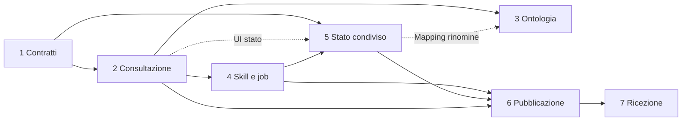
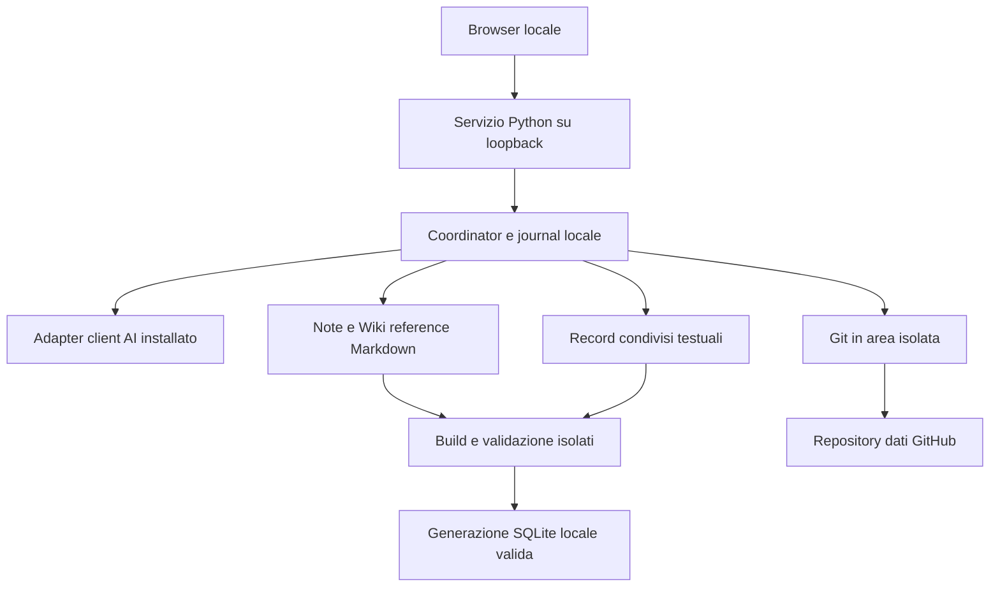

# Dashboard e collaborazione Teseo — piano di implementazione

Avanzamento runtime e analisi ECC: [registro implementazioni](08-analisi-avanzamento.md).
Le sezioni progettuali seguenti descrivono il piano originario; il registro distingue
gli incrementi implementati dalle funzionalità ancora future.

Stato: passi 1–6 implementati, passo 7 parziale (rilevamento opt-in e adozione manuale, ora anche su POSIX), passi 9 e 10 implementati; lo stato di ciascun passo è in testa al suo documento e il dettaglio in [08](08-analisi-avanzamento.md). Metodo: ECC Blueprint; proposta del 22 ottobre 2026, aggiornata il 25 ottobre 2026. Ciò che il documento di un passo non dichiara implementato resta proposta.

## Risultato atteso

Una persona collega alla dashboard un vault Teseo già installato, consulta note e grafo, modifica le convenzioni e avvia le skill tramite il proprio client. Dopo ingest e lint conclusi e validati, il servizio integra le novità remote in un'area isolata e pubblica automaticamente sul repository dati GitHub. Gli altri partecipanti, ciascuno con il proprio clone e account, importano gli aggiornamenti quando il vault è libero. Le PR sono una policy facoltativa; il percorso diretto automatico è il caso principale.

Il kit software resta distinto dal repository dati. Markdown è l'autorità delle note e dell'ontologia; record testuali versionati sono l'autorità dello stato condiviso. I database sono proiezioni locali, salvo storia personale preesistente da migrare o conservare con backup. Il servizio è l'unico coordinatore delle operazioni gestite, ma deve rilevare anche modifiche di Obsidian, editor, hook e comandi esterni.

## Documenti e dipendenze

| Passo | Documento | Prerequisiti | Consegna |
| --- | --- | --- | --- |
| 1 | [Contratto dati e operazioni](01-contratto-dati-operazioni.md) | nessuno | Versioni, confini, journal, concorrenza, build sicuro |
| 2 | [Dashboard di consultazione](02-dashboard-consultazione.md) | 1 | Collegamento vault, servizio locale e UI readonly |
| 3 | [Editor ontologia](03-editor-ontologia.md) | 1, 2; 5 per mapping di pagine condivise | Preview e migrazioni delle convenzioni |
| 4 | [Coordinamento ingest/lint](04-coordinamento-ingest-lint.md) | 1, 2 | Adapter, ricevuta esplicita, attribuzione delle scritture |
| 5 | [Stato condiviso](05-stato-condiviso.md) | 1 per formato; 2 per UI; 4 per consolidamento | Eventi idempotenti e proiezioni locali |
| 6 | [Pubblicazione GitHub](06-pubblicazione-github.md) | 1, 2, 4, 5 | Onboarding, integrazione isolata e push ordinario |
| 7 | [Ricezione automatica](07-ricezione-automatica.md) | 1, 2, 5, 6 | Poll, import, recovery e convergenza multi-clone |
| 9 | [Autosync collaborativo](09-autosync-collaborativo.md) | 6, 7 | Pull prima e commit+push dopo ogni skill, opt-in per vault |
| 10 | [Autori, causa-effetto, editor e visualizzazione](10-editor-grafo-e-autori.md) | 3, 9 | Autori da Git, relazione `causa`, modifica del grafo dalla dashboard, layout a forze, apply anche su POSIX |
| 13 | [Decisione sull'apply automatico](13-decisione-apply-automatico.md) | 3, 10 | Decisione proposta: l'apply automatico non è previsto; criteri per riaprirla |
| 12 | [Autenticazione reale e collaudo avanzato](12-piano-autenticazione-e-collaudo-avanzato.md) | 9, 11 | Piano: configurazione reale dei credential helper, SSH, repository privato, branch protetto, due account, igiene dei segreti |
| 11 | [Piano per chiudere i punti aperti](11-piano-completamento.md) | 10 | CI su tre sistemi, collaudo reale, client AI, PR, adozione legacy, pagine create/rinominate, scala |
| 14 | [Convenzioni ICM e lavorazioni della wiki](14-piano-icm.md) | 4, 9 | Implementato (B5 deciso diversamente): contratti nelle skill, guardia contro la deriva, correzioni come segnale; pipeline ICM configurabili che leggono la wiki e producono documenti derivati |
| 15 | [Decisione: condivisione delle lavorazioni](15-condivisione-lavorazioni.md) | 14 | Proposta: le lavorazioni restano personali; si condividono a mano con `esporta`/`nuova --modelli`; punti da modificare e criteri per riaprire la condivisione nel repository dati |

La freccia 4→5 riguarda la transazione di consolidamento: il formato degli eventi può essere sviluppato dopo 1 in parallelo a 2. Dopo 2, UI ontologia e adapter possono avanzare in parallelo solo assegnando file distinti; API, journal e router condivisi richiedono integrazione sequenziale. Il passo 3 non blocca la prima sincronizzazione di vault con ontologia stabile; ogni variazione dello schema attraversa comunque i controlli del passo 1. I singoli passi contengono incrementi da una PR ciascuno; i sette documenti non implicano sette sole PR.

## Architettura proposta

Sorgenti nel kit: `kit/dashboard/` con moduli `contracts`, `storage`, `graph_service`, `server`, `operations`, `adapters`, `shared_state`, `git_sync`, `receiver` e altri, più asset UI. L'installatore (`--dashboard`) li distribuisce e risolve il runtime senza copiarli dal repository dati. I nomi restano modificabili con aggiornamento coordinato dei documenti.

Nel vault: `.teseo/project.json` portabile, `.teseo/shared/events/` condivisa; `.teseo/local/` esclusa da Git per registro del vault, journal, lock, checkpoint, generazioni e cache. Il file `Wiki reference.md` rimane l'unica autorità dello schema: niente secondo vocabolario JSON modificabile indipendentemente. Il manifest registra solo versioni, identificatore del vault e selezione dati; non contiene token, percorsi assoluti o endpoint arbitrari eseguibili.

## Decisioni comuni e gate

1. Un'operazione ha UUID, revisione Git base, digest dei file e manifest di scritture; `Stop` del client non ne prova la riuscita.
2. Build, validate e publish sono fasi separate. Un errore preserva l'ultima generazione valida. I lettori dichiarano la revisione dei dati letti.
3. Una modifica estranea sospende l'applicazione; nessuno stash, reset, force push o commit indiscriminato automatico. Hash e watcher non garantiscono esclusione atomica di scrittori esterni: l'apply automatico richiede modalità cooperativa o esclusione verificata sulla piattaforma. In assenza, richiedere la sospensione degli scrittori esterni e dichiarare il limite.
4. Una nuova fonte può essere aggiunta a `raw/`; nessun file preesistente può essere mutato, eliminato o rinominato. Confrontare hash e percorsi rispetto alla base, anche dopo un merge.
5. L'import esegue sempre controlli deterministici e rebuild. La riconciliazione semantica è mirata alle informazioni correlate integrate, con deduplicazione per revisioni e versione della policy; non è un lint mutante a ogni pull.
6. Compatibilità schema, eventi e kit viene controllata prima di qualsiasi scrittura. Dati ricevuti non attivano script o hook.
7. Il consolidamento delle risposte è per ID e parte dello stesso checkpoint logico delle note. SQLite e filesystem richiedono journal e recovery: non esiste una transazione nativa unica fra i due.

Gate di rilascio integrato: due clone modificano la stessa nota; note distinte descrivono fatti correlati incompatibili; entrambi aggiornano index/log; immutabilità raw con nuove fonti ammesse; doppio import/no-op; offline e arresti in ogni fase; push rifiutato; protezioni del branch e consenso client; editor esterno durante job/import; lettore SQLite aperto su Windows; due lint concorrenti; risposta consolidata mentre ne arriva una nuova. I passi 1, 4, 5, 6 e 7 assegnano questi casi a verifiche osservabili.

## Esecuzione, rollout e manutenzione del piano

Prima di implementare rileggere le istruzioni applicabili, verificare stato Git e preservare modifiche esistenti. Il preflight di questa redazione ha trovato branch `main`, upstream `origin/main`, working tree inizialmente pulito, Git disponibile e autenticazione `gh` non valida. L'implementazione futura ricontrolla le credenziali solo quando servono; questa redazione non richiede accesso remoto autenticato.

Ogni incremento futuro usa un branch `codex/<scopo>` e una PR se il workflow di sviluppo lo prevede; nessun branch viene creato da questa consegna. Separare il workflow di sviluppo software dalla policy facoltativa di PR del repository dati. Per contratti, migrazioni e sync richiedere revisione approfondita; per UI readonly e fixture basta revisione ordinaria, mantenendo il modello configurato dall'utente.

Abilitare in ordine: servizio readonly, scritture locali con backup, eventi condivisi, pubblicazione manualmente attivata, quindi automatismi esplicitamente configurati. Un rollback disabilita il modulo o la policy e conserva dati e journal; non riporta forzatamente indietro branch condivisi. Migrazioni non reversibili richiedono backup verificato e scelta dell'utente.

Per cambiare il piano: aggiornare prima il contratto interessato, elencare motivazione e impatto, modificare dipendenze, fixture e criteri d'uscita dei documenti coinvolti. Un passo saltato deve lasciare una motivazione verificabile; non considerarlo completato. Registrare le decisioni in questa sezione e nel documento interessato. Questo indice svolge anche la funzione di registro del piano, senza modificare memorie fuori da `doc/`.

## Riferimenti tecnici

- [Architettura del motore](architettura-motore.md): componenti, schemi SQLite,
  pipeline di recall, memoria, contratti degli hook e guida per aggiungere un client.
- [Recall come KPI](kpi-recall.md): metriche del banco, perché il massimo dipende
  dal banco, baseline, regola di non regressione e strategie di miglioramento.
- [Analisi ECC del retrieval](analisi-retrieval-ecc.md): varianti del recall misurate
  sul banco con gate e holdout; raccomanda il ripiego a cascata.
- [Lavorazioni](lavorazioni.md): guida alle pipeline ICM che leggono la wiki e producono documenti derivati.
- [Analisi ECC dell'Interpretable Context Methodology](analisi-icm-ecc.md): integrabilità
  di ICM nelle istruzioni del vault; adottare convenzioni e ciclo «correggere la fonte», non le cartelle di fase.
- [Riferimento API](api.md): moduli, classi e funzioni pubbliche, generato dai
  docstring con `script/genera_api_doc.py` (verificato da `tests/test_api_doc.py`).

## Verifiche e fonti

Esistono `python installa.py --prova` e `python -m unittest discover -s tests -v` dalla root, documentati nel [README del kit](../README.md), da eseguire per ogni modifica runtime. I comandi `.graph/...` nei documenti si eseguono nel vault installato, non nella root del kit. Gli endpoint `/api/v1` e i test `test_dashboard_*` sono implementati per i passi dichiarati tali nei rispettivi documenti. Su Windows senza percorsi lunghi (`LongPathsEnabled=0`) il limite di 260 caratteri vale anche per i vault: le operazioni che scrivono rifiutano con `path_too_long` un vault la cui radice supera il massimo calcolato in `contracts.max_vault_path_length`, e i test usano una temp dir corta (`tests/_shortpath.py`).

Sono stati letti README, istruzioni modello del vault, builder, hook, stato domande/memoria e skill ingest/lint. `kit/vault/AGENTS.md` riguarda il modello installato nel vault; nessun `AGENTS.md` applicabile è stato trovato nella root o negli antenati controllati. I riferimenti locali in ogni documento permettono di riaccertare le assunzioni senza dipendere dalla conversazione.

Riferimenti primari verificati per la progettazione: [Git pull](https://git-scm.com/docs/git-pull), [Git hooks](https://git-scm.com/docs/githooks), [webhook GitHub](https://docs.github.com/en/webhooks/about-webhooks), [limite localhost dei webhook](https://docs.github.com/en/webhooks/testing-and-troubleshooting-webhooks/troubleshooting-webhooks#url-host-localhost-is-not-supported). Rimangono da scegliere librerie server/UI e capacità effettive degli adapter sulle versioni client installate; nessuna integrazione SDK è data per disponibile.
