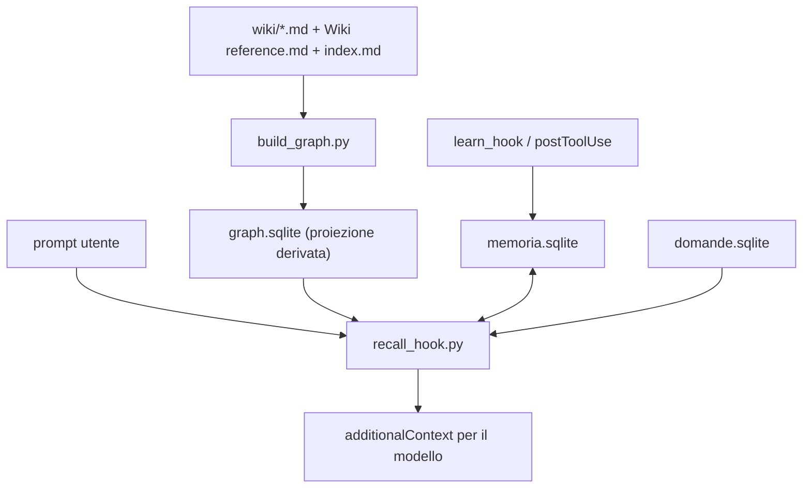

# Architettura del motore Teseo

Riferimento tecnico del nucleo: grafo, recall, memoria, domande aperte e contratti
degli hook dei tre client. Per il piano dashboard/collaborazione vedi
[l'indice dei passi](README.md); per le firme delle funzioni pubbliche vedi
[api.md](api.md). Il contratto a parole di ogni modulo è il suo docstring.

## 1. Mappa dei componenti

| Percorso | Ruolo |
| --- | --- |
| `installa.py` | Installa/aggiorna il kit in un vault; registra gli hook dei client senza toccare dati, permessi o trust globali. |
| `kit/graph/build_graph.py` | Costruisce `graph.sqlite` dalle pagine `wiki/*.md`; `--check` valida senza ricostruire in caso di errori. |
| `kit/graph/recall.py` | Dato un prompt, restituisce i fatti collegati dal grafo (CLI e libreria). |
| `kit/graph/recall_hook.py` | Pipeline pre-risposta condivisa: rebuild se serve, recall, memoria, domande aperte, degrado controllato. |
| `kit/graph/memoria.py` | Persistenza dell'apprendimento (`memoria.sqlite`) e log dei turni. |
| `kit/graph/learn_hook.py` | Post-lettura: registra le pagine effettivamente lette e chiude i turni. |
| `kit/graph/domande.py` | Rileva e archivia le domande aperte del vault (`domande.sqlite`). |
| `kit/graph/graph_db.py` | Apertura readonly del grafo, con risoluzione delle generazioni immutabili. |
| `kit/graph/claude_hook.py` | Adattatore Claude Code: smista ai motori, ignora i payload importati da Copilot. |
| `kit/graph/codex_hook.py` | Adattatore Codex: 4 eventi nativi, token di turno, suggerimento di ruolo. |
| `kit/graph/copilot_hook.py` | Adattatore Copilot CLI: 6 eventi nativi, stato per sessione. |
| `kit/graph/copilot_timing_hook.py` | Durata dei tool Copilot CLI: ms in timeline e log `.graph/timing.jsonl`. |
| `kit/graph/modello_hook.py` | Motore storico Claude: recall + routing Opus/Haiku (prefisso `@opus` per restare su Opus). |
| `kit/graph/chiedi_codex.py` | Query autonoma Codex con scelta effettiva del modello (Sol/Astra/Luna). |
| `kit/graph/leggi.py` | Lettura da shell che insegna alla memoria solo con token di turno valido. |
| `kit/graph/misura.py` | Banco di prova del recupero su domande configurate per vault. |
| `kit/graph/sintesi.py` | Trova risposte distribuite fra più pagine, candidate a una pagina di sintesi (tag `entropia`). |
| `kit/graph/correzioni.py` | Legge la storia Git attribuita (trailer `Teseo-Skill`) e raggruppa le correzioni manuali ricorrenti del frontmatter in proposte per schema e skill. Solo lettura. |
| `kit/graph/piano.py` | Controlla un piano di ingest contro il grafo e il vocabolario prima che si scrivano le pagine. Solo lettura. |
| `kit/graph/lavorazioni.py` | Lavorazioni ICM: validazione, creazione da modello, raccolta deterministica dal grafo con impronte SHA-256, stato delle fasi. Non scrive in `wiki/` né in `raw/`. |
| `kit/graph/contratti.py` | Valida i contratti ICM (Input, Processo, Checkpoint, Verifica, Output): file e sezioni citati, riferimenti in avanti, segnaposto. Solo lettura. |
| `kit/dashboard/` | Servizio locale, UI, contratti e collaborazione: vedi i documenti dei passi 1–9. |

Gli script di `kit/graph/` sono copiati dall'installatore nella `.graph/` del vault:
lì lavorano con `cwd` = radice del vault e percorsi relativi ad essa.

## 2. Flusso dei dati

Autorità e derivazioni:

- **Markdown è l'autorità**: pagine, convenzioni (`Wiki reference.md`) e fonti
  (`raw/`, immutabili). I database si ricostruiscono sempre dai file.
- `graph.sqlite` è una proiezione: se una pagina, `index.md` o `Wiki reference.md`
  è più recente del DB, `recall_hook.py` lo ricostruisce prima di rispondere.
- Nei vault con `.teseo/project.json` compatibile il builder pubblica **generazioni
  immutabili**: `.teseo/local/graph-current.json` (manifest con `generation`,
  `content_revision`, `sqlite_sha256`) indirizza il file
  `.teseo/local/graphs/<generation>.sqlite`, aperto con `immutable=1` e verificato
  contro `graph_metadata`. Un manifest invalido solleva `GraphDatabaseError` senza
  sostituire l'ultima vista valida. Il percorso `.graph/graph.sqlite` resta quello legacy.

## 3. Schemi SQLite

### `graph.sqlite` (derivato, ricostruibile)

| Tabella | Contenuto |
| --- | --- |
| `entities` | `id` (nome pagina), `tipo`, `descrizione`, `path`, `tags`, `aggiornato` |
| `relations` | `source_id`, `target_id`, `type`; unique su tripla; indici su source e target. Le relazioni tipizzate vengono dal frontmatter; i `[[wikilink]]` nel testo diventano `menziona`. |
| `aliases` | `entity_id`, `alias` |
| `varianti` | forme grafiche generate (es. «Service Desk» ↔ «ServiceDesk») |
| `testo` | FTS5 (`unicode61`, diacritici rimossi): `id`, `titolo`, `corpo`, `radici_titolo`, `radici_corpo` (testo già ridotto a radici: FTS5 non può usare uno stemmer Python) |
| `onto_tipi`, `onto_relazioni`, `onto_vincoli`, `onto_metadata` | copia in sola lettura dell'ontologia di `Wiki reference.md` (tipi dichiarati o osservati, relazioni con significato ed esempio, vincoli `Da`/`A`, digest dello schema), riscritta a ogni build ([doc/16](16-tassonomia-ontologia-nel-grafo.md)) |
| `graph_metadata` | `content_revision` e `generation` (modalità a generazioni) |

### `memoria.sqlite` (apprendimento, personale)

| Tabella | Contenuto |
| --- | --- |
| `domande` | testo normalizzato, prima/ultima occorrenza, conteggio |
| `pagine_lette` | associazioni domanda → pagina con conteggio (la memoria che alimenta il recall) |
| `sospese` | domande in attesa delle letture del turno, per sessione |
| `letture` | pagine lette per sessione |
| `turni` | log per prompt: testo scritto, semi con origine (`nome`/`titolo`/`memoria`/`testo`), pagine iniettate, routing; retention 90 giorni (`GIORNI_TURNI`) |
| `letture_turno` | pagine lette per turno (collegate da `learn_hook` / `postToolUse`) |

### `domande.sqlite` (lacune del vault)

| Tabella | Contenuto |
| --- | --- |
| `aperte` | domande rilevate (referenti mancanti, contraddizioni, punti aperti): chiave, segnale, pagina, stato, date, rinvii |
| `risposte` | risposte dell'autore alle domande, con flag di consolidamento |
| `poste` | domande già mostrate nella sessione (mai due volte la stessa) |
| `scartate` | domande scartate con motivo |

## 4. Pipeline di recall

`recall.py` lavora **solo sul testo scritto dall'utente**: i blocchi incollati
(`<pasted_content>`) e i rapporti dei sub-agent (`<agent-message>`) sono tolti
prima di cercare, instradare e memorizzare.

1. **Punti di partenza per nome**: nomi di pagina e alias citati (case/diacritici
   insensibili, vince il nome più lungo), più le `varianti` generate dal builder.
   I nomi che sono anche parole comuni (`PAROLE_COMUNI`) valgono solo con la maiuscola.
2. **Punti di partenza per titolo**: pagine le cui parole del titolo compaiono nella
   domanda, confrontate per radice (stemmer Snowball italiano, `stemmer.py`) e vicine
   fra loro entro una finestra.
3. **Cammino sul grafo**: 1° passo su tutti gli archi; dal 2° solo lungo relazioni
   tipizzate e nello stesso verso (i link generici portano agli hub e i «fratelli»
   sono rumore). In avanti fino al 3° passo (le catene si stringono verso prerequisiti
   e referenti), a ritroso fino al 2° (si allargano).
4. **Potatura e limiti**: 3+ fratelli collassano in un fatto solo; tutte le relazioni
   tipizzate (tetto `MAX_TIPIZZATE`) e al più `MAX_MENZIONA` link generici per punteggio.
   Ciò che resta fuori è contato e dichiarato in coda («N link generici omessi»).
   Le pagine `entropia` sono punti di partenza solo se nominate e non proseguono catene.
5. **Memoria** (solo nell'hook): alle pagine nominate si aggiungono quelle lette in
   passato per domande simili.
6. **Ripiego sul testo** (`per_testo`): se grafo e memoria non danno punti di partenza
   **e** il prompt è una domanda sul contenuto (`memoria.e_domanda`: non comandi,
   conferme, modifiche o domande sul sistema), ricerca FTS5 per radici e per date in
   linguaggio naturale (mappate alle fonti `call-AAAA-MM-GG*`). Al più `MAX_TESTO`
   pagine sopra soglia, dichiarate come aggancio debole («trovate nel testo, non per
   nome»). Parole presenti in più di `SOGLIA_FREQUENTE` pagine non contano; una parola
   rara (≤ `SOGLIA_RARA` pagine, ≥ `MIN_RARA` lettere, aspetto da nome) vale come
   identificatore da sola; le sole parole comuni devono stare vicine (metà del minimo
   in una finestra di `FINESTRA_TESTO` parole). Se il primo giro non trova nulla,
   un secondo giro (`per_testo_a_cascata`) allarga la finestra a `FINESTRA_TESTO_LARGA`
   e la soglia a `SOGLIA_FREQUENTE_LARGA`, con al più `MAX_TESTO_LARGO` pagine: recupera
   le domande parafrasate (vedi [analisi-retrieval-ecc.md](analisi-retrieval-ecc.md)).
   Il ripiego non si mescola con la
   memoria: le letture passate sono un segnale più forte.

Nessun punto di partenza → nessun output di fatti; l'hook mostra all'utente
«nessuna pagina riconosciuta» e al modello l'avviso di cercare in `wiki/`
senza rispondere dalla conoscenza generale. Non è un guasto: non porta `MARCA_GUASTO`.

## 5. Memoria e apprendimento

La memoria apprende solo da **letture confermate**: una pagina conta come letta se il
client segnala l'apertura riuscita del file (`view` con `resultType: success` in
Copilot, `Read` in Claude, `leggi.py --turno` in Codex). Risultati di `rg`, `grep` o
`glob` **non** provano una lettura. `leggi.py` senza token legge soltanto.

A fine turno (`Stop`/`agentStop`) o sessione (`sessionEnd`) le associazioni fra la
domanda in sospeso e le pagine lette si consolidano in `pagine_lette`. Il log dei
turni (`memoria.py --turni`) confronta pagine suggerite e pagine lette: è lo
strumento per diagnosticare il recall.

## 6. Contratti degli hook

Ogni adattatore legge un evento JSON su stdin e stampa un oggetto JSON su stdout;
un errore non blocca mai la richiesta dell'utente (degrado a istruzioni di ricerca).

| Client | Eventi | Dove si registra |
| --- | --- | --- |
| Claude Code | `SessionStart`, `UserPromptSubmit`, `PostToolUse` (matcher `Read`), `Stop` | `.claude/settings.json` → `claude_hook.py` |
| Codex | `SessionStart`, `UserPromptSubmit`, `PostToolUse`, `Stop` | `.codex/hooks.json` → `codex_hook.py` |
| Copilot CLI | `sessionStart`, `userPromptSubmitted`, `userPromptTransformed`, `postToolUse`, `agentStop`, `sessionEnd` | `.github/hooks/teseo.json` (versione 1) → `copilot_hook.py` |
| Copilot CLI (timing) | `preToolUse`, `postToolUse`, `postToolUseFailure` | `.github/hooks/teseo.json` (versione 1) → `copilot_timing_hook.py` |

Regole specifiche:

- **Claude**: `claude_hook.py` distingue i payload Copilot importati da
  `.claude/settings.json` (campo `sessionId`, o `timestamp` senza `permission_mode`)
  e li ignora stampando `{}`; i payload Claude (`hook_event_name`, `transcript_path`)
  sono inoltrati a `modello_hook.py` / `learn_hook.py`.
- **Codex**: la sessione di turno è `codex:[session_id, turn_id]` (JSON delimita le
  parti senza collisioni). `UserPromptSubmit` salva `codex-turni/<sha256(sessione)>.json`
  e aggiunge al contesto il token per `leggi.py`; gli handle più vecchi di 7 giorni
  sono rimossi a ogni evento. Gli eventi con `agent_id` sono ignorati (turni dei
  sub-agent). Il contesto suggerisce il ruolo Sol/Astra/Luna ma non cambia il modello
  della chat né avvia altri modelli; la scelta effettiva è solo in `chiedi_codex.py`.
- **Copilot**: `userPromptSubmitted` calcola il recall e salva lo stato in
  `.graph/copilot-sessioni/<sha256(sessionId)>.json` (il suo stdout è ignorato dalla
  CLI); `userPromptTransformed` aggiunge il blocco `<teseo-context id="...">` al
  prompt già trasformato dal runtime, senza raddoppiare se l'evento si ripete
  (marker idempotente) e ricalcolando se il prompt è cambiato (`prompt_hash`).
  `postToolUse` registra solo `view` riuscite su `wiki/*.md`. `agentStop` chiude il
  turno, `sessionEnd` archivia la sessione ed elimina il file di stato.
  `copilot_timing_hook.py` misura i tool: `preToolUse` salva l'avvio in
  `.graph/timing-stato/<sha256(sessionId)>.json` (pila FIFO per tool, il payload
  non ha id di chiamata), `postToolUse`/`postToolUseFailure` emettono una riga
  `{"type": "progress"}` con i ms (visibile in timeline, ignorata dal modello) e
  appendono a `.graph/timing.jsonl` istante, tool, ms, esito, argomenti e
  anteprima del risultato. Errori e stdin non valido degradano a `{}` con exit 0:
  `preToolUse` è fail-closed, quindi l'hook non deve mai fallire.

Formato Copilot verificato con CLI 1.0.83; senza `userPromptTransformed` il recall
resta disponibile via skill query.

## 7. Affidabilità

- **Degrado dichiarato**: se la ricostruzione del grafo fallisce ma `graph.sqlite`
  esiste, si usa il grafo precedente dichiarandolo (`AVVISO_GRAFO_VECCHIO`); errori
  nelle domande aperte perdono solo le domande; qualsiasi altro errore produce comunque
  un JSON con istruzioni di ricerca (`AVVISO_SENZA_GRAFO`). Le righe di guasto iniziano
  con `MARCA_GUASTO`, che il routing Claude usa per non affidare mai a Haiku un prompt
  senza recall affidabile.
- **Variabili d'ambiente di test**: `GRAFO_SENZA_MEMORIA=1` esclude la memoria,
  `GRAFO_SENZA_DOMANDE=1` esclude le domande aperte (le imposta `misura.py`).
- **Concorrenza**: scritture di stato atomiche (file temporaneo + `os.replace`);
  sessioni isolate per hash; gli eventi dei sub-agent non sporcano la memoria.
- **Limiti di piattaforma**: su Windows senza `LongPathsEnabled` le operazioni di
  scrittura rifiutano vault oltre il massimo calcolato (`contracts.max_vault_path_length`)
  con `path_too_long`.

## 8. Aggiungere un nuovo client

1. Adattatore in `kit/graph/<client>_hook.py`: stdin JSON → `gestisci(evento)` → stdout
   JSON; chiama `recall_hook.py` come sottoprocesso, mai `modello_hook.py` (motore Claude).
2. Registrazione in `installa.py`: funzione `unisci_hook_<client>` che preserva gli
   handler estranei, fa backup ed è idempotente; aggiungere il client a `clienti()`,
   `COPILOT_SCRIPT`-style set se serve, percorsi skill e istruzioni.
3. Istruzioni in `kit/vault/` e blocco nel README (tabella «Client supportati»).
4. Test di contratto in `tests/test_<client>.py` sul modello di `test_copilot.py`:
   merge/backup/idempotenza della configurazione, trasformazione del prompt, memoria
   delle sole letture riuscite, degrado a recall rotto, isolamento delle sessioni.
