# Teseo — guida completa: concetto, funzionamento, evoluzione e casi d'uso

Questa guida accompagna le due presentazioni: [teorica](teseo-presentazione-teorica.pptx) (le idee, 19 slide) e
[tecnica](teseo-presentazione-tecnica.pptx) (il funzionamento nel dettaglio, 50 slide). Ne è la versione
estesa: spiega **perché** Teseo esiste, **da quale idea parte**, **come l'ho adattata e rafforzata** nei suoi punti
deboli, **come funziona** dal livello alto fino ai dettagli del motore, **come gestisce i casi difficili**, **come si sta
evolvendo** e **dove si usa in azienda**.

Stato descritto: branch `ICM_Integration`, 30 ottobre 2026. Ogni affermazione tecnica è ricavata dal codice e dai
documenti del repository; i riferimenti puntuali sono in fondo a ogni capitolo.

**Indice**

1. [Il problema: passaggi di consegna e documentazione dispersa](#1-il-problema)
2. [L'idea: il labirinto, Teseo e il filo di Arianna](#2-lidea)
3. [Il punto di partenza: il pattern LLM Wiki](#3-il-punto-di-partenza-il-pattern-llm-wiki)
4. [Punti deboli del pattern e come Teseo li rafforza](#4-punti-deboli-del-pattern-e-come-teseo-li-rafforza)
5. [Anatomia di un vault](#5-anatomia-di-un-vault)
6. [Il ciclo di vita della conoscenza](#6-il-ciclo-di-vita-della-conoscenza)
7. [Il grafo e il vocabolario delle relazioni](#7-il-grafo-e-il-vocabolario-delle-relazioni)
8. [Il recall: dalla domanda alla risposta](#8-il-recall-dalla-domanda-alla-risposta)
9. [La memoria delle letture](#9-la-memoria-delle-letture)
10. [Domande aperte e lacune](#10-domande-aperte-e-lacune)
11. [Pagine generate per entropia](#11-pagine-generate-per-entropia)
12. [Tre client AI sullo stesso vault](#12-tre-client-ai-sullo-stesso-vault)
13. [Gestione delle casistiche](#13-gestione-delle-casistiche)
14. [Collaborazione: un vault condiviso con Git](#14-collaborazione-un-vault-condiviso-con-git)
15. [Controllo, sicurezza e decisioni di prodotto](#15-controllo-sicurezza-e-decisioni-di-prodotto)
16. [La dashboard locale](#16-la-dashboard-locale)
17. [ICM: istruzioni come contratti](#17-icm-istruzioni-come-contratti)
18. [Le lavorazioni: documenti derivati dalla wiki](#18-le-lavorazioni-documenti-derivati-dalla-wiki)
19. [Qualità misurata](#19-qualità-misurata)
20. [Come si sta evolvendo](#20-come-si-sta-evolvendo)
21. [Casi d'uso aziendali](#21-casi-duso-aziendali)
22. [Adottarlo in azienda: percorso consigliato](#22-adottarlo-in-azienda-percorso-consigliato)
23. [Glossario](#23-glossario)

---

## 1. Il problema

Teseo nasce da un problema concreto: **il passaggio di consegne dei progetti aziendali**.

In un progetto la conoscenza utile non sta in un posto solo. Sta nelle call registrate, nei manuali, nelle mail, nei
ticket, negli appunti personali e soprattutto nella testa di chi ci ha lavorato. Quando una persona cambia progetto,
va in ferie o lascia l'azienda, succede sempre la stessa cosa:

| Sintomo | Effetto sul progetto |
| --- | --- |
| **Conoscenza dispersa** in documenti eterogenei | chi arriva non sa da dove iniziare a leggere |
| **Conoscenza tacita** (chi chiamare, perché si fa così, le eccezioni) | non è scritta da nessuna parte e si perde |
| **Documentazione che invecchia** | nessuno sa più quale versione è vera; le contraddizioni restano nascoste |
| **Nessuna tracciabilità** | non si sa da quale fonte viene un'informazione né chi l'ha scritta |
| **Condivisione difficile** | cartelle, wiki e drive diversi, senza regole comuni né controllo su chi cambia cosa |

L'obiettivo di Teseo è quindi triplice: **raccogliere** la documentazione in modo facile, **renderla interrogabile**
da chi subentra con risposte che citano le fonti, e **condividerla in modo adattabile e controllato** tra più persone.

## 2. L'idea

La metafora dà il nome al progetto:

| Nel mito | In Teseo |
| --- | --- |
| Il **labirinto** | l'insieme dei documenti di un progetto |
| **Teseo** | l'assistente AI che lo esplora per conto tuo |
| Il **filo di Arianna** | il grafo delle relazioni tra le pagine, che orienta l'assistente e gli permette di tornare alle fonti |

In pratica: si copiano i documenti grezzi in una cartella, l'assistente li **distilla** in pagine Markdown collegate
(una per sistema, processo, persona, concetto), un piccolo database locale registra **come** le pagine sono collegate,
e a ogni domanda gli hook del client AI iniettano nel contesto del modello i fatti collegati e le pagine da leggere.
L'assistente legge, verifica e **risponde citando le fonti**; contraddizioni e informazioni mancanti restano visibili.

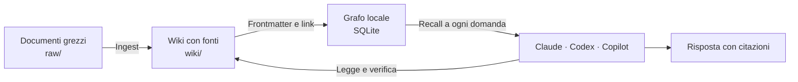

Scelte di fondo, che spiegano molte decisioni successive:

- **File locali e testo semplice**: Markdown + SQLite, nessun server, unica dipendenza Python PyYAML. Obsidian è
  facoltativo: i contenuti sono normali file.
- **Markdown è l'autorità**: i database si ricostruiscono sempre dalle pagine.
- **Il modello non inventa**: legge le pagine, cita, dichiara ciò che manca.
- **L'umano decide**: nessuna scrittura delle note avviene senza conferma; le domande sui fatti vanno all'autore.

## 3. Il punto di partenza: il pattern LLM Wiki

Teseo parte dal pattern [LLM Wiki di Andrej Karpathy](https://gist.github.com/karpathy/442a6bf555914893e9891c11519de94f):
invece di far cercare al modello nei documenti originali a ogni domanda (RAG classico), il modello **mantiene una wiki**
distillata dalle fonti, che diventa la base delle risposte.

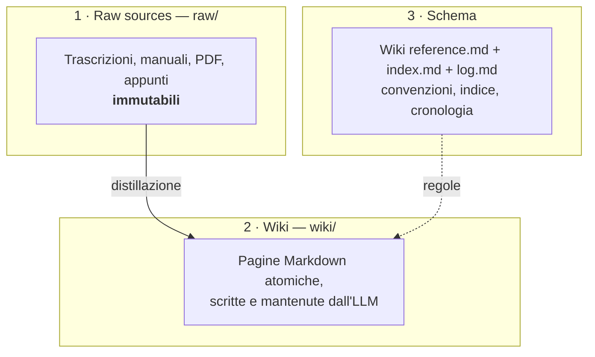

Tre operazioni: **ingest** (una fonte nuova diventa pagine), **query** (si interroga la wiki, non i raw), **lint**
(la wiki si controlla e si ripulisce).

## 4. Punti deboli del pattern e come Teseo li rafforza

Il pattern è un'idea, non un sistema: lascia al modello quasi tutto. Usandolo su progetti reali sono emersi limiti
precisi; ognuno ha avuto una risposta nel codice.

| # | Limite del pattern originale | Rafforzamento in Teseo | Dove |
| --- | --- | --- | --- |
| 1 | Il modello deve **trovare da solo** le pagine giuste (lista file, grep) | **Grafo tipizzato** + **recall automatico** iniettato dagli hook prima di ogni risposta | `build_graph.py`, `recall.py`, `recall_hook.py` |
| 2 | I link dicono solo «collegato», non **come** | **Vocabolario di relazioni** (`usa`, `richiede`, `referente`, `causa`…) con tipi ammessi e controllo | `Wiki reference.md`, `build_graph.py --check` |
| 3 | Il sistema **non impara** dalle domande | **Memoria** che associa domande e pagine effettivamente lette | `memoria.py`, `learn_hook.py` |
| 4 | Le **lacune** restano invisibili | **Domande aperte** calcolate dal vault e poste all'autore, una alla volta | `domande.py`, skill lacune |
| 5 | Le **contraddizioni** tendono a essere «appianate» dal modello | Regola non negoziabile: si **registrano** e si risolvono con l'autore | schema, lint |
| 6 | Le risposte **sparse** su più pagine si ricostruiscono ogni volta | **Pagine per entropia**: sintesi senza fatti nuovi, verificate | `sintesi.py`, lint |
| 7 | Qualità **non misurabile** | `--check` deterministico, banco di prova, **KPI del recall**, 849 test, CI su 3 sistemi | `misura.py`, `banco.py`, `tests/` |
| 8 | **Monoutente** | Repository dati Git condiviso, **pull/push automatici** dalle skill, autori da Git | `teseo_git.py`, `kit/dashboard/` |
| 9 | Legato a **un client** | **Claude Code, Codex e Copilot CLI** sullo stesso vault | `*_hook.py`, `installa.py` |
| 10 | Istruzioni **opache e lunghe** | **Contratti ICM** (Input, Processo, Checkpoint, Verifica, Output) validati | `contratti.py` |
| 11 | La wiki serve solo a rispondere | **Lavorazioni**: pipeline che producono report e schede dalla wiki | `lavorazioni.py` |
| 12 | Nessuna interfaccia di controllo | **Dashboard locale**: grafo, ontologia, diagnostica, pubblicazione, lavorazioni | `kit/dashboard/` |

## 5. Anatomia di un vault

```text
MioVault/
├── raw/                    Fonti originali, immutabili
├── wiki/                   Pagine Markdown con frontmatter e wikilink (piatte, senza sottocartelle)
├── Wiki reference.md       Convenzioni, fonti e vocabolario delle relazioni (lo «schema»)
├── index.md                Indice delle pagine e punti aperti
├── log.md                  Cronologia delle operazioni
├── lavorazioni/            Pipeline di documenti derivati (personali)
├── .graph/                 Script Python, grafo e memoria SQLite
├── .teseo/                 Manifest, eventi condivisi; .teseo/local/ = journal, generazioni, lock (mai in Git)
├── .claude/ .codex/ .agents/ .github/   Hook e skill dei tre client
├── CLAUDE.md               Istruzioni Claude Code
└── AGENTS.md               Istruzioni Codex
```

**Chi comanda su cosa** — distinzione fondamentale per capire robustezza e recupero:

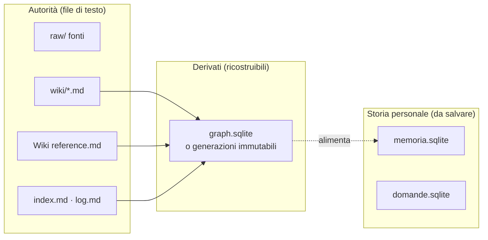

- Il grafo è **una proiezione**: se una pagina è più recente del DB, viene ricostruito prima di rispondere.
- `memoria.sqlite` e `domande.sqlite` **non** si ricostruiscono: sono storia (domande apprese, risposte, rinvii) e si
  salvano con `backup_personal.py`.
- Nei vault gestiti dalla dashboard il grafo è pubblicato a **generazioni immutabili** con impronta SHA-256: un build
  fallito non sostituisce mai l'ultima vista valida.

### Una pagina

```markdown
---
tipo: processo
tags: [rilascio]
fonti: [call-2026-09-10]
aggiornato: 2026-10-05
usa: "[[Console di rilascio]]"
---

# Rilascio in produzione

Ogni rilascio passa dalla [[Console di rilascio]] [call-2026-09-10].
⚠️ da verificare: il giorno di rilascio, mercoledì secondo il manuale e venerdì secondo la call.
```

Cinque proprietà hanno un ruolo fisso (`tipo`, `tags`, `fonti`, `aggiornato`, `aliases`); **ogni altra proprietà è
una relazione** e deve essere nel vocabolario. Ogni affermazione non ovvia porta la chiave della fonte, con il
timestamp se c'è (`[call-2026-08-28 34:39]`).

## 6. Il ciclo di vita della conoscenza

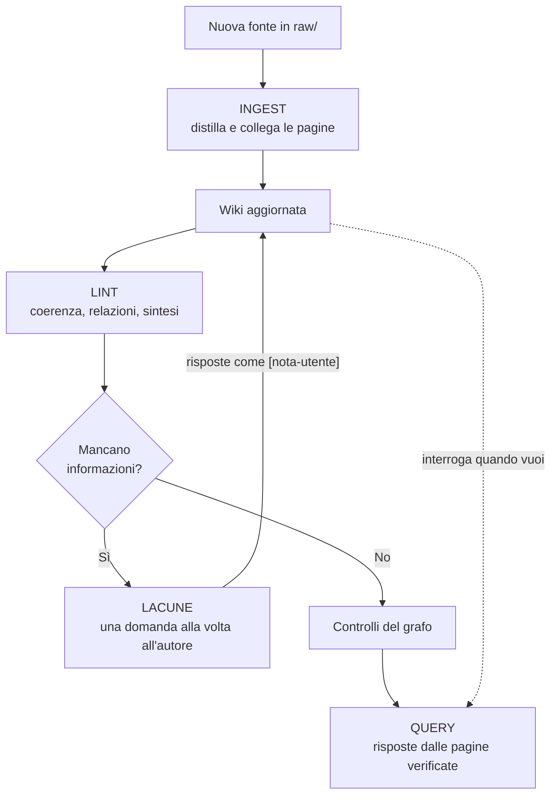

Cinque skill, identiche per i tre client:

| Skill | Cosa fa | Punti chiave |
| --- | --- | --- |
| `obsidian-wiki-ingest` | fonte → pagine | distilla (non trascrive), pagine atomiche, aggiorna 10–15 pagine esistenti, segnala contraddizioni, aggiorna `index.md` e `log.md`, chiude con `build_graph.py --check`. Per una fonte importante scrive prima un **piano** modificabile |
| `obsidian-wiki-query` | domanda → risposta | parte dal recall, legge le pagine, cita; se la risposta non c'è risale al raw e propone la pagina mancante |
| `obsidian-wiki-lint` | manutenzione | duplicati, orfane, link non risolti, `⚠️ da verificare` risolvibili, relazioni mancanti, pagine per entropia, correzioni ricorrenti |
| `obsidian-wiki-fill-gaps` | lacune | domande aperte all'autore, una alla volta; le risposte entrano come `[nota-utente]` |
| `obsidian-wiki-lavorazioni` | documenti derivati | esegue le fasi di una lavorazione rispettando contratti e checkpoint |

**Cadenza consigliata**: lint dopo ogni ingest; una sessione di lacune breve ogni settimana (10–15 domande); un lint
completo ogni due settimane.

### L'ingest nel dettaglio

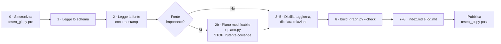

Il **piano di ingest** applica un principio semplice: *correggere un file costa meno che correggere quindici pagine*.
`piano.py` controlla che la fonte esista, che le pagine da creare non esistano e quelle da aggiornare sì, che le
relazioni siano nel vocabolario con tipi ammessi e che gli alias non collidano.

## 7. Il grafo e il vocabolario delle relazioni

`build_graph.py` legge `wiki/*.md` e costruisce:

| Tabella | Contenuto |
| --- | --- |
| `entities` | una riga per pagina: nome, tipo, descrizione (da `index.md`), tag, data |
| `relations` | archi tipizzati dal frontmatter; i `[[wikilink]]` nel testo diventano `menziona` |
| `aliases` | altri nomi della pagina (sigle, «Cognome Nome», errori di trascrizione risolti) |
| `varianti` | grafie generate («Service Desk» ↔ «ServiceDesk») |
| `testo` | indice full-text FTS5 con radici italiane (stemmer Snowball) |

**Vocabolario** (estendibile per dominio in `Wiki reference.md`):

| Relazione | Significato | Esempio |
| --- | --- | --- |
| `parte_di` | X è componente o fase di Y | Modulo fatture → Gestionale |
| `usa` | X funziona tramite lo strumento Y | Rilascio in produzione → Console di rilascio |
| `richiede` | X non parte senza Y | Console di rilascio → Incident settimanale |
| `precede` | X viene prima di Y nella catena | Censimento profili → Caricamento notturno |
| `causa` | X provoca Y (solo se la fonte lo afferma; confidenza ed evidenza facoltative) | Backup fallito → Report incompleto |
| `referente` | Y è la persona a cui rivolgersi per X | Incident settimanale → Anna Rossi |
| `variante_di` | X è un gemello di Y per un caso particolare | Rilascio d'emergenza → Rilascio in produzione |
| `sostituisce` | X prende il posto di Y | Portale 2026 → Portale 2019 |
| `riguarda` | X ha Y come oggetto | Errore del 3 marzo → Rilascio in produzione |
| `da_non_confondere` | X e Y si scambiano facilmente | Anna Rossi → Anna Rosso |

Il vault d'esempio, come grafo:

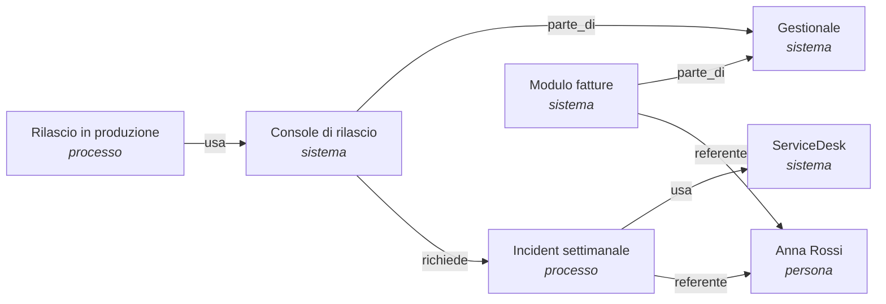

`build_graph.py --check` segnala relazioni fuori vocabolario, tipi non ammessi, link non risolti, fonti non censite,
alias duplicati e frontmatter YAML non valido. **Valida prima di sostituire**: in caso di errore il grafo precedente
resta in uso.

## 8. Il recall: dalla domanda alla risposta

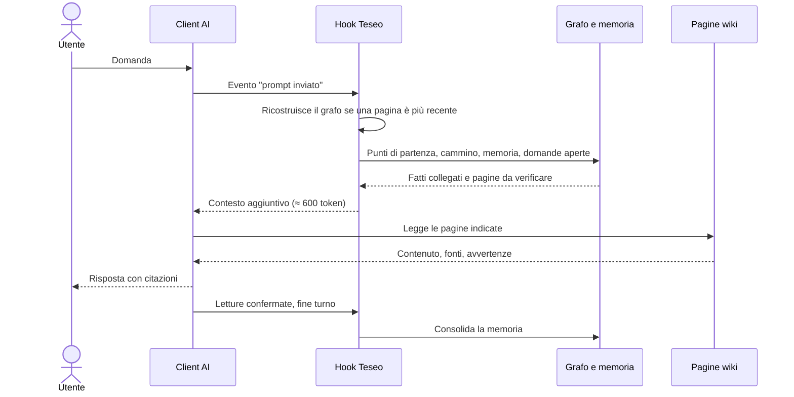

La pipeline, passo per passo (`recall.py`, lavora **solo sul testo scritto dall'utente**: i blocchi incollati e i
messaggi dei sub-agent sono tolti prima):

| Passo | Cosa fa | Perché |
| --- | --- | --- |
| 1 · Semi per nome | nomi di pagina, alias e varianti citati (vince il più lungo; le parole comuni contano solo con la maiuscola) | precisione: «Portale» ≠ «portale» |
| 2 · Semi per titolo | parole del titolo presenti nella domanda, confrontate per **radice** e vicine | «rilasciare» trova «Rilascio» |
| 3 · Cammino | 1° passo su tutti gli archi; poi solo relazioni tipizzate e nello stesso verso; fino a 3 passi in avanti, 2 a ritroso | le catene si stringono verso prerequisiti e referenti; i link generici portano agli hub |
| 4 · Potatura | 3+ «fratelli» diventano un fatto solo; tetto ai link generici; ciò che resta fuori è **dichiarato** | contesto piccolo e onesto |
| 5 · Memoria | si aggiungono le pagine lette in passato per domande simili | il sistema impara |
| 6 · Ripiego sul testo | solo se non ci sono semi **e** il prompt è una domanda sul contenuto: FTS5 per radici e date; secondo giro più largo se il primo è vuoto | domande parafrasate, dichiarate come «aggancio debole» |

**Esempio reale** sul vault d'esempio — domanda: *«Devo fare un rilascio in produzione: cosa mi serve e chi me lo dà?»*

```text
Dal grafo della wiki (5 fatti):
- Rilascio in produzione [processo]: come si rilascia
- Rilascio in produzione → usa → Console di rilascio
- Console di rilascio → parte_di → Gestionale
- Console di rilascio → richiede → Incident settimanale
- Incident settimanale → usa → ServiceDesk
- Incident settimanale → referente → Anna Rossi
```

La domanda nomina una sola pagina, ma il cammino arriva al **prerequisito** (incident settimanale) e alla **persona**
(Anna Rossi) in tre passi. L'hook aggiunge anche la domanda aperta sulla contraddizione del giorno di rilascio
(mercoledì nel manuale, venerdì nella call): la risposta deve riportarla, non sceglierne una.

## 9. La memoria delle letture

La memoria impara **solo da letture confermate**: una pagina conta se il client segnala l'apertura riuscita del file
(`Read` in Claude, `view` riuscita in Copilot, `leggi.py --turno TOKEN` in Codex). Un risultato di `grep` o `glob`
**non** è una lettura.

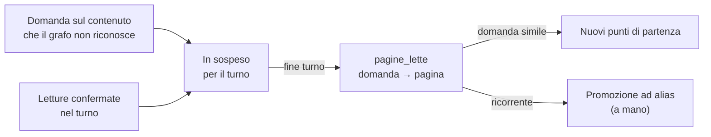

Non impara da comandi, conferme, modifiche e domande sul sistema; gli eventi dei sub-agent sono ignorati;
`memoria.py --dimentica` toglie una voce sbagliata; `memoria.py --turni` confronta pagine suggerite e lette, turno per
turno: è lo strumento di diagnosi del recall.

## 10. Domande aperte e lacune

Il vault sa dire **che cosa non sa**. `domande.py` calcola le domande per l'autore da quattro segnali:

| Segnale | Esempio |
| --- | --- |
| Punti aperti di `index.md` | «Giorno di rilascio: mercoledì o venerdì?» |
| Righe `⚠️ da verificare` | nome tecnico trascritto in modo incerto |
| Sistemi, processi e progetti **senza referente** | «Chi è il referente di Gestionale?» |
| Domande **scartate** dal lint perché il vault non bastava | sintesi impossibili |

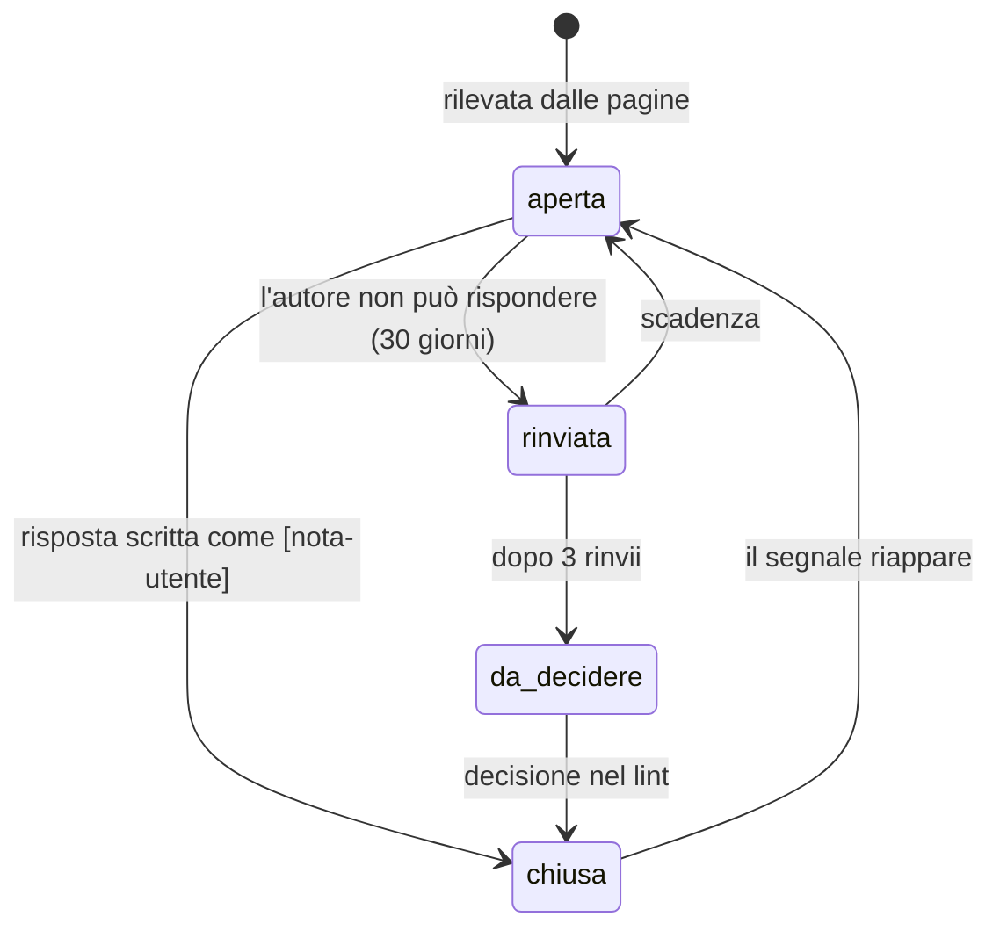

Regole: al più **3 domande** per prompt, ognuna **una sola volta per sessione**; il calcolo dalle pagine comanda
(una domanda che non si rileva più si chiude da sola). È qui che la **conoscenza tacita** diventa scritta: è il cuore del
caso d'uso «passaggio di consegne».

## 11. Pagine generate per entropia

Quando una risposta esiste già ma è **sparsa su più pagine**, il lint scrive una pagina di sintesi:

- nasce solo da domande calcolate dal grafo (`sintesi.py`): catene `usa`/`richiede`/`referente`, termini condivisi,
  persone referenti di più pagine, domande apprese dalla memoria;
- `tipo: riferimento`, tag `entropia`, avviso in testa, link a **ogni** pagina della risposta;
- **nessun fatto nuovo**: se manca un pezzo, la pagina non si scrive e la domanda diventa una lacuna per l'autore;
- `sintesi.py --verifica` controlla avviso, copertura e fonti.

## 12. Tre client AI sullo stesso vault

| | Claude Code | Codex | Copilot CLI |
| --- | --- | --- | --- |
| Istruzioni | `CLAUDE.md` | `AGENTS.md` | `.github/copilot-instructions.md` |
| Hook | `.claude/settings.json` | `.codex/hooks.json` | `.github/hooks/teseo.json` |
| Eventi | SessionStart, UserPromptSubmit, PostToolUse, Stop | gli stessi 4 | sessionStart, userPromptSubmitted, userPromptTransformed, postToolUse, agentStop, sessionEnd |
| Instradamento | Opus / Haiku: le domande puntuali con contesto affidabile possono andare a Haiku; `@opus` lo evita | ruoli Sol / Astra / Luna suggeriti; scelta effettiva solo con `chiedi_codex.py` | modello attivo di Copilot; misura dei tempi dei tool |

Ogni adattatore legge un evento JSON e scrive JSON; **un errore non blocca mai la richiesta** dell'utente. Si può
usare un solo client o alternarli: la memoria e il grafo sono gli stessi.

## 13. Gestione delle casistiche

### Motore (grafo, recall, memoria)

| Caso | Comportamento | Principio |
| --- | --- | --- |
| La domanda non nomina nessuna pagina | ripiego sul testo (se è una domanda sul contenuto), dichiarato «aggancio debole»; altrimenti avviso «cerca in `wiki/`, non rispondere dalla conoscenza generale» | niente invenzioni |
| Domanda parafrasata («il sistemino che cerca gli errori») | secondo giro di ripiego più largo, al più 2 pagine | recall senza rumore |
| Domanda fuori tema | nessun fatto; i casi negativi sono nel banco di prova | 0 semi spuri |
| Frontmatter YAML rotto | il build si ferma nominando la pagina; si usa il grafo precedente **dichiarandolo** | degrado visibile |
| Recall in errore | JSON con istruzioni di ricerca; il routing non manda mai a Haiku un prompt senza recall affidabile | mai bloccare l'utente |
| Contraddizione tra fonti | registrata nella pagina e nei punti aperti; diventa domanda per l'autore | non appianare |
| Nome incerto da trascrizione | `⚠️ da verificare` finché una fonte scritta non lo conferma | fonti scritte prevalgono |
| Precisazione dell'autore | entra come `[nota-utente]`, prevale sulla fonte che corregge | l'autore ha l'ultima parola |
| Fonte da «correggere» | `raw/` non si modifica mai: si aggiunge una fonte nuova | immutabilità |
| Grep spacciato per lettura | non insegna alla memoria | solo letture confermate |
| Testo incollato o rapporti di sub-agent | esclusi da semi, memoria e routing | conta ciò che scrive l'utente |
| Client senza hook o versione vecchia | la skill query descrive il recall esplicito | funziona comunque |
| Vault già esistente | `ADATTA.md` passo per passo; adozione esplicita (`--adotta`) per la dashboard | nessuna migrazione forzata |
| Input ostili (link enormi, simboli) | espressioni regolari lineari con tetto; collegamenti simbolici rifiutati | sicurezza |

### Collaborazione e scritture

| Caso | Comportamento |
| --- | --- |
| Rete assente all'inizio della skill | prosegue offline e lo segnala (exit 3) |
| Rete assente alla fine | commit locale, stato `waiting`; si riprende con `teseo_git.py riprendi` |
| Modifiche locali non pubblicate | `pre` si ferma (exit 2) e spiega come pubblicarle |
| Storie divergenti | si ferma e rimanda alla dashboard: niente merge nel vault vivo |
| **Stessa nota** modificata da due persone | pubblicazione fermata; risoluzione con revisione umana dalla dashboard |
| **Note collegate** nel grafo modificate in parallelo | fermata anche se i file sono diversi (fatti correlati possono essere incompatibili) |
| Aggiunte concorrenti a `log.md` e `index.md` | unite automaticamente (`merge-file --union`) se entrambi i lati aggiungono soltanto |
| Fonti binarie (PDF) | restano locali, segnalate; si condivide il testo distillato |
| Segreti nei file | scansione prima della pubblicazione; percorsi ammessi solo da allowlist |
| Obsidian aperto durante un apply | apply solo con conferma `manual_paused` (editor e hook sospesi); file creato durante l'apply → `recovery_conflict` esplicito |
| Arresto a metà operazione | journal e recovery esplicito; nessun replay automatico |
| Branch protetto | modalità PR: il servizio propone il branch, apertura e merge restano manuali |
| Credenziali | delegate a Git (helper di sistema, `gh`); `teseo_git.py diagnosi` mostra come ci si autentica |
| Lavorazioni importate da altri | avviso: i contratti sono istruzioni per il modello, da leggere prima di avviare |

## 14. Collaborazione: un vault condiviso con Git

Il **kit** (questo repository) e i **dati** (il vault) stanno in repository distinti. Il vault si condivide in un
repository GitHub dedicato:

```sh
python installa.py "PERCORSO_DEL_VAULT" --collabora https://github.com/organizzazione/vault-dati.git
```

| Situazione | Risultato |
| --- | --- |
| Cartella con note e remoto vuoto | anteprima di cosa si condivide, conferma, primo push |
| Cartella vuota e remoto popolato | clona, installa il kit, attiva la collaborazione |
| Remoto inesistente | crealo su GitHub o usa `--crea-remote` (con `gh`, previa conferma) |

Da quel momento ogni skill che scrive si apre e si chiude con la sincronizzazione:

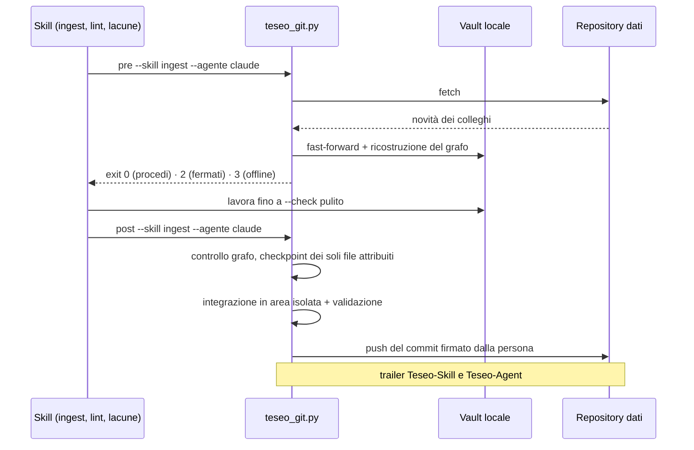

**Tracciabilità**: ogni commit ha come autore la persona (identità Git) e i trailer `Teseo-Skill` (ingest, lint,
lacune, manuale, dashboard) e `Teseo-Agent` (claude, codex, copilot, umano). Da questa storia la dashboard ricava gli
**autori di ogni nota** e `correzioni.py` riconosce le correzioni manuali ricorrenti.

## 15. Controllo, sicurezza e decisioni di prodotto

Principi che rendono la condivisione **controllata**:

1. **Le fonti non si toccano**: in `raw/` si può solo aggiungere.
2. **Build, validazione e pubblicazione sono fasi separate**: un errore conserva l'ultima versione valida.
3. **Integrazione in area isolata**: mai un merge nel vault vivo; l'adozione locale è solo fast-forward.
4. **Nessuno stash, reset, force push o commit indiscriminato** automatico.
5. **Allowlist dei percorsi e scansione dei segreti** prima del push; Git non interattivo, senza hook.
6. **I dati ricevuti non attivano script o hook.**
7. **Opt-in**: senza `--collabora` nessuna pubblicazione è automatica.

Due decisioni di prodotto, documentate con i criteri per riaprirle:

| Decisione | Perché |
| --- | --- |
| **Niente apply automatico** delle note dal servizio ([13](../13-decisione-apply-automatico.md)) | nessun sistema impedisce davvero a Obsidian di scrivere nello stesso momento: si rischierebbe di perdere modifiche non salvate. Pull e push restano automatici; le scritture delle note richiedono conferma |
| **Lavorazioni non condivise nel repository dati** ([15](../15-condivisione-lavorazioni.md)) | una pagina è un fatto da verificare, un contratto è un ordine per il modello: condividerli darebbe a chiunque scriva sul remoto un modo di istruire il modello di tutti. Si condividono a mano con `esporta` / `nuova --modelli` |

## 16. La dashboard locale

Un servizio Python su **loopback** (nessuna esposizione in rete, token di sessione e CSRF) con interfaccia nel browser:

| Area | Funzioni |
| --- | --- |
| Consultazione | grafo a forze (zoom, pan, colori per tipo, vicinato espandibile, fino a 2000 nodi), lista, filtri per tipo, relazione e autore, dettaglio nota |
| Ontologia | editor del vocabolario con anteprima, valutazione d'impatto, migrazioni con recovery |
| Editor del grafo | aggiungi/togli relazioni, alias, tag, tipo; crea, rinomina, elimina pagine con link riscritti; sempre anteprima → apply con conferma |
| Diagnostica | revisione dei contenuti, generazione del grafo, export diagnostico senza contenuti |
| Pubblicazione Git dei dati | preview, checkpoint, push, modalità PR, risoluzione conflitti, autosync |
| Ricezione | rilevamento opt-in delle novità remote, candidato isolato, adozione manuale |
| Lavorazioni | stato delle pipeline in sola lettura |

```sh
python .graph/teseo_dashboard.py --vault "C:/Obsidian/MioVault"
```

## 17. ICM: istruzioni come contratti

L'ultima evoluzione integra l'**Interpretable Context Methodology** (Van Clief, McDermott, 2026): le istruzioni per il
modello sono file di testo strutturati, leggibili e correggibili dall'umano. Analisi ([analisi-icm-ecc](../analisi-icm-ecc.md)):
adottarne la **disciplina di scrittura** e il ciclo «correggere la fonte, non l'output»; **non** le cartelle di fase
nella wiki, incompatibili con il grafo.

Ogni skill e ogni fase ha la stessa forma:

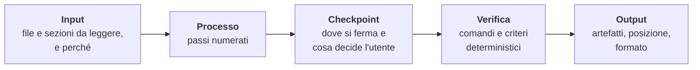

| Voce | Risultato |
| --- | --- |
| `contratti.py` | valida sezioni, file e sezioni citati, riferimenti in avanti, segnaposto; `--peso` misura il contesto caricato |
| Guardia contro la deriva | un test fallisce se le istruzioni duplicate per scelta (una per client) divergono |
| Lettura selettiva dello schema | query e lacune leggono solo le sezioni utili: ~3.089 token invece di ~4.410 (−30%), ~839 per una query che non archivia (−81%) |
| Piano di ingest | superficie modificabile prima di scrivere le pagine |
| Correzioni come segnale | `correzioni.py`: se le correzioni a mano dello stesso tipo ricorrono (≥ 3 volte su ≥ 2 pagine scritte da ingest o lint) propone di cambiare lo **schema o la skill**, non le pagine |

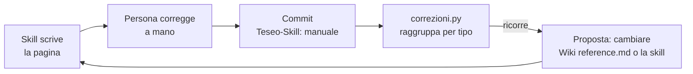

## 18. Le lavorazioni: documenti derivati dalla wiki

Una **lavorazione** è una pipeline ripetibile che legge la wiki e produce un documento (report periodico, scheda di
argomento, scaletta). **Non scrive mai in `wiki/`**: un risultato entra nella wiki solo come nuova fonte in `raw/`.

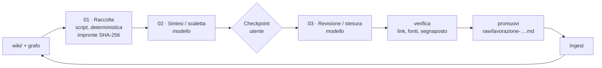

| Comando | Cosa fa |
| --- | --- |
| `lavorazioni.py nuova NOME --da MODELLO` | crea da un modello (`report-periodico`, `scheda-argomento`) |
| `avvia NOME [--param chiave=valore]` | nuova esecuzione e raccolta dal grafo |
| `stato NOME` | COMPLETA, IN ATTESA o **DA RIFARE** con il motivo (pagina cambiata, contratto cambiato, output a monte corretto) |
| `verifica NOME --fase NN [--citazioni]` | ogni link esiste ed è nella raccolta, ogni fonte è censita, nessun segnaposto |
| `promuovi NOME` | output finale → `raw/` con provenienza; mai sovrascrivere |
| `esporta NOME CARTELLA` | definizione da condividere a mano |

La raccolta la fa lo **script**, non il modello: ogni output è riconducibile alle pagine (e alla loro versione) da cui
nasce, e quando una pagina cambia `stato` lo dice.

## 19. Qualità misurata

| Strumento | Cosa garantisce |
| --- | --- |
| `build_graph.py --check` | coerenza strutturale del vault: obiettivo «nessun problema» |
| `misura.py` | **regressione**: domande di prova con le pagine attese, casi negativi, routing |
| `misura.py --solo-banco` | **KPI**: domande scritte come le farebbe un collega, senza le parole dei titoli; si segue nel tempo con baseline datate |
| `memoria.py --turni` | diagnosi turno per turno: pagine suggerite e pagine lette |
| Suite di test | 849 test (587 prima dell'integrazione ICM), nessun modello chiamato |
| CI | ruff, mypy e suite su Linux, Windows e macOS (9 job) |
| Collaudi reali | GitHub reale con due cloni (9 scenari), editor non cooperante (Obsidian reale) |

**Il metodo ECC applicato al retrieval** (27 ottobre, vault reale di 213 pagine, banco di 106 domande e 134 pagine
attese): una variante = un'ipotesi, gate di correttezza obbligatori, holdout pari/dispari, promozione solo con zero
domande peggiorate.

| Variante | Pagine attese portate | Domande complete | Peggiorate | Esito |
| --- | ---: | ---: | ---: | --- |
| Baseline | 88/134 (66%) | 72 | – | – |
| Finestra di testo larga sempre | 96 | 78 | 4 | scartata |
| Fusione grafo + testo sempre | 90 | 74 | 16 | scartata (semi spuri) |
| PageRank personalizzato | 83 | 67 | 15 | scartata |
| **Ripiego a cascata (adottato)** | **102/134 (76%)** | **82** | **0** | **promossa** |

Lezione: il collo di bottiglia è il **vocabolario** (la domanda non nomina la pagina), non il cammino sul grafo. Per
questo le leve principali sono gli alias dal parlato e le relazioni tipizzate, con `candidati.py` che li propone.

## 20. Come si sta evolvendo

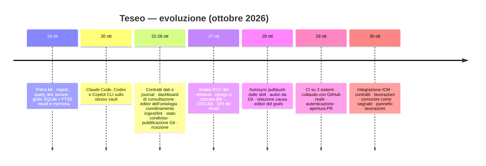

Le tre fasi dell'evoluzione:

1. **Dal pattern al motore** (19–20 ottobre): grafo, recall, memoria, lacune, tre client.
2. **Dal singolo al gruppo** (22–29 ottobre): contratti dati, dashboard, collaborazione Git controllata, collaudi reali.
3. **Dalle risposte al lavoro** (30 ottobre): istruzioni come contratti verificabili e pipeline che producono documenti.

**Cosa resta aperto** (dichiarato nei documenti, non nascosto):

| Punto | Stato |
| --- | --- |
| Comportamento del modello con skill riscritte, piano di ingest, lettura selettiva | da provare con un client AI autenticato (`skill-comply`, gate di 10 domande) |
| Collaudo avanzato | repository privato con branch protetto, SSH, due account distinti |
| Condivisione delle lavorazioni nel repository dati | non prevista finché il proprietario non sceglie chi può modificarle |
| Snapshot con molte fonti pesanti | tetto di 64 MiB da rendere selettivo prima di vault con molti PDF |
| Vicinato dei conflitti | euristico e conservativo: in wiki molto collegate più fermate |

## 21. Casi d'uso aziendali

### Caso principale: il passaggio di consegne

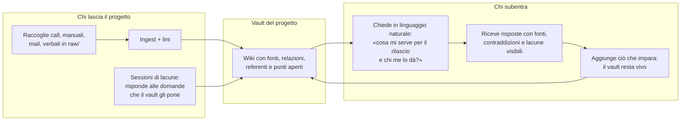

Perché funziona per le consegne: le **lacune** obbligano a scrivere la conoscenza tacita *prima* che la persona se ne
vada (referenti mancanti, punti aperti, nomi da verificare); le **relazioni** `referente` rispondono a «a chi chiedo?»;
le **fonti con timestamp** permettono di tornare al punto esatto della call; la **storia Git** dice chi ha scritto cosa.

### Altri casi d'uso

| Caso d'uso | Fonti tipiche | Cosa offre Teseo |
| --- | --- | --- |
| **Onboarding** di nuovi colleghi | manuali, registrazioni di formazione, FAQ | risposte citate, percorsi tra sistemi e processi, report «scheda argomento» per area |
| **IT operations / service desk** | runbook, ticket, post-mortem | catene `richiede`/`usa` per i prerequisiti, `referente` per l'escalation, relazione `causa` per gli incidenti |
| **Gestione di progetto e decisioni** | verbali di riunione, call, stati di avanzamento | decisioni tracciate alla fonte, contraddizioni esplicite, report periodico delle pagine cambiate |
| **Consulenza e progetti cliente** | documenti del cliente, call, specifiche | un vault per cliente/commessa, condivisione controllata con il team, consegna finale come documento derivato |
| **Qualità, audit e compliance** | procedure, policy, evidenze | fonti immutabili, citazioni puntuali, storia attribuita, nessuna scrittura senza conferma |
| **Knowledge base di prodotto e rilasci** | specifiche, changelog, manuali | componenti (`parte_di`), sostituzioni (`sostituisce`), varianti, sintesi per entropia |
| **Supporto commerciale / pre-vendita** | schede prodotto, offerte, casi | risposte rapide con fonte, schede argomento generate e verificate |
| **Continuità operativa** | procedure critiche, contatti | chi chiamare, cosa serve prima, cosa succede se manca — tutto navigabile dal grafo |

### Perché è adatto a un contesto aziendale

| Requisito aziendale | Risposta di Teseo |
| --- | --- |
| Dati sotto controllo | file locali; il repository dati è dell'azienda (anche privato); il kit è separato |
| Nessun lock-in | Markdown e SQLite, tre client AI intercambiabili, Obsidian facoltativo |
| Adattabile al dominio | vocabolario delle relazioni, tipi e fonti definiti in `Wiki reference.md`, modificabili anche dall'editor dell'ontologia |
| Controllo delle modifiche | conferme esplicite, revisione dei conflitti, modalità PR, autori da Git |
| Tracciabilità | ogni fatto con la sua fonte; ogni modifica con persona, agente e operazione |
| Misurabilità | KPI del recall, segnali di salute del vault, domande aperte in calo |

> Nota: i contenuti letti dall'assistente possono essere inviati al provider del modello secondo la configurazione del
> client AI: va valutato con le policy aziendali sui dati.

## 22. Adottarlo in azienda: percorso consigliato

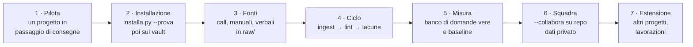

1. **Scegliere un progetto pilota** in cui c'è un passaggio di consegne reale.
2. **Installare** (`python installa.py --prova`, risultato atteso `tutto OK`; poi `python installa.py "PERCORSO"`).
3. **Adattare lo schema**: ambito del vault, relazioni e tipi del dominio, chiavi delle fonti.
4. **Ingerire** le fonti principali, con il piano per quelle importanti; poi lint e lacune con chi lascia il progetto.
5. **Misurare**: 10 domande vere nel banco, baseline datata, segnali di salute.
6. **Aprire alla squadra**: repository dati privato, `--collabora`, dashboard per revisione e conflitti.
7. **Estendere**: altri progetti, lavorazioni per report periodici e schede.

## 23. Glossario

| Termine | Significato |
| --- | --- |
| **Vault** | la cartella che contiene fonti, wiki, schema e strumenti di un progetto |
| **Fonte** (`raw/`) | documento originale, immutabile, citato con una chiave |
| **Pagina** (`wiki/`) | nota atomica su un sistema, processo, persona, concetto o episodio |
| **Schema** | `Wiki reference.md`: convenzioni, vocabolario delle relazioni, chiavi delle fonti |
| **Relazione tipizzata** | proprietà del frontmatter che dice *come* due pagine sono legate |
| **Recall** | i fatti del grafo e le pagine da leggere, iniettati nel contesto a ogni domanda |
| **Seme** | pagina da cui parte il cammino sul grafo |
| **Memoria** | associazioni domanda → pagine effettivamente lette |
| **Domanda aperta / lacuna** | ciò che il vault non sa e che solo l'autore può chiudere |
| **`[nota-utente]`** | precisazione dell'autore, che prevale sulla fonte che corregge |
| **Pagina per entropia** | sintesi di una risposta sparsa, senza fatti nuovi |
| **Skill** | istruzioni operative per il client AI (ingest, query, lint, lacune, lavorazioni) |
| **Contratto** | forma di skill e fasi: Input, Processo, Checkpoint, Verifica, Output |
| **Lavorazione** | pipeline che produce documenti derivati dalla wiki |
| **Repository dati** | repository Git del vault condiviso, distinto dal kit |
| **Autosync** | pull prima e commit + push dopo ogni skill, opt-in per vault |
| **Generazione** | versione immutabile e verificata del grafo |
| **ECC** | Everything Claude Code: le skill di metodo (blueprint, verification-loop, security-review…) con cui Teseo è stato progettato e verificato |
| **ICM** | Interpretable Context Methodology: istruzioni come file strutturati e verificabili |

---

**Riferimenti nel repository**: [README](../../README.md) · [ADATTA](../../ADATTA.md) ·
[architettura del motore](../architettura-motore.md) · [KPI del recall](../kpi-recall.md) ·
[analisi del retrieval](../analisi-retrieval-ecc.md) · [analisi ICM](../analisi-icm-ecc.md) ·
[piano ICM](../14-piano-icm.md) · [lavorazioni](../lavorazioni.md) · [autosync](../09-autosync-collaborativo.md) ·
[indice dei passi](../README.md) · [CHANGELOG](../../CHANGELOG.md)
